# KOA Agentic-RAG System

**Evidence-Grounded Agentic Retrieval-Augmented Generation for Knee Osteoarthritis Clinical Guidelines**

[](#g-current-implementation-status)
[](#e-benchmark--koa-guidelinebench-rc020)
[-ca8a04)](#d-how-the-agentic-workflow-operates)
[](#f-experimental-design--protocol-e1-v2)
[](#i-limitations-and-research-status)
[](#i-limitations-and-research-status)

> **Research Disclosure:** This repository presents the scientific architecture, benchmark governance contracts, prospective experimental design, and verified offline engineering evidence for the **KOA Agentic-RAG System** (`KOA-GuidelineBench` $\times$ `DV-OGEC-RAG`). It is an academic research publication repository—**not** a clinically validated decision-support product. Real-provider `E1-v2` execution (`NOT_EXECUTED`) and independent owner-referenced clinical quality scoring (`NOT_EVALUABLE`, `0/16` in public scope) remain separate downstream gates. No claim of clinical accuracy, patient safety, or empirical superiority over baseline RAG methods is made.

---

## A. Project Overview

Answering clinical questions from **clinical practice guidelines (CPGs)** for knee osteoarthritis (KOA) poses strict requirements that standard single-pass Retrieval-Augmented Generation (`Retrieve` $\rightarrow$ `Generate`) does not structurally enforce:

1. **Evidence Sufficiency & Multi-Obligation Coverage:** A clinical question often entails multiple material obligations—such as target patient phenotype, comorbidity contraindications, modality dosing, and strength of recommendation. Generating an answer when initial retrieval ($E_0$) satisfies only part of these obligations risks clinically misleading omissions.
2. **Source Authority & Temporal Scope:** Guidelines differ in issuing authority, language, and currency (e.g., current international guidelines from **EULAR 2023**, **NICE NG226 2022**, **ACSQHC 2024**, and **VA/DoD 2026** versus historical national guidance from **BYT Vietnam 2014**). Evidence acquisition and verification must obey explicit source-scope constraints prior to similarity scoring and answer emission.
3. **Agentic Retrieval & Dual Verification (`PRE` and `POST`):** Rather than treating retrieval and generation as an open-loop pipeline, an agentic RAG system must plan explicit verification sub-goals, evaluate pre-generation evidence readiness (`PRE`), execute **bounded corrective retrieval** ($\le 1$) when initial evidence is insufficient, decompose candidate answers into **atomic claims**, and verify claim-level support and obligation completeness (`POST`) with **bounded grounded revision** ($\le 1$).
4. **Deterministic Answer Control & Selective Abstention:** Probabilistic language model confidence or unconstrained reflection tokens must never override hard safety and provenance constraints. A deterministic **`PolicyGuard`** must govern every state transition and force a legitimate terminal abstention (`COMPLETED_ABSTAIN`) whenever evidence readiness or post-generation claim support fails.

---

## B. Research Contributions

This research program connects two independently versioned, strictly separated contributions:

| Contribution Pillar | Artifact / System | Core Methodological & Engineering Scope |
| :--- | :--- | :--- |
| **1. Benchmark Contribution** | **`KOA-GuidelineBench` (`rc0.2.0`)** | Multi-authority KOA clinical guideline benchmark comprising **276 native `EvidenceUnit` records** and **170 `SemanticIntent` records** across **5 guideline sources**, with cryptographic document SHA-256 provenance, page/section locators, explicit task contracts for **Displayed-Bundle Sufficiency (Task B)** and **Corpus Recovery & Evidence Gating (Task C)**, and formal three-layer exposure governance (`BA1-D1` / `BA1-D2`). |
| **2. Method Contribution** | **`DV-OGEC-RAG`** *(Dual-Verification Obligation-Guided Evidence-Controlled RAG)* | An evidence-grounded agentic RAG architecture combining **question-only obligation planning**, **local MedCPT + FAISS source-scoped retrieval**, **deterministic all-obligation PRE readiness gating**, **bounded corrective retrieval ($\le 1$)**, **atomic claim decomposition**, **member-bound staged POST verification (`v4`)**, **bounded grounded revision ($\le 1$)**, and a **deterministic `PolicyGuard`** control plane. |

*Attribution Note:* The `DV-OGEC-RAG` method architecture, research engine, and this publication repository are authored by **Phạm Hồng Đăng Khoa** (`KwanFam26022005`) and **Nguyễn Hoàng Khang**. `KOA-GuidelineBench` (`rc0.2.0`) is governed as an independent benchmark release candidate (`public_release = false`) whose sealed evaluator capsule (`evaluator/`) and audit lineage (`audit_provenance/`) remain strictly external to the method runtime.

---

## C. Overall System Architecture

The principal architectural diagram below illustrates the complete `DV-OGEC-RAG` agentic execution lifecycle as verified against the production runtime contracts (`dv_ogec_rag/runner_workflow.py`, `dv_ogec_rag/runner.py`, and `dv_ogec_rag/control.py`).

```mermaid
%%{init: {'theme': 'base', 'themeVariables': {'background': '#ffffff', 'primaryColor': '#f8fafc', 'primaryTextColor': '#0f172a', 'primaryBorderColor': '#475569', 'lineColor': '#334155', 'secondaryColor': '#f1f5f9', 'tertiaryColor': '#ffffff', 'fontFamily': 'Inter, Segoe UI, Arial, sans-serif', 'fontSize': '13px'}, 'flowchart': {'curve': 'basis', 'nodeSpacing': 30, 'rankSpacing': 42, 'padding': 12}}}%%
flowchart TD
  Q["1. Clinical Question (RuntimeQuestion: sample_id, question_text, locked_source_scope; zero gold fields)"]

  subgraph PREP["Shared Preparation (Executed Once per Question x Replicate)"]
    direction TB
    PLAN["2. Obligation Planner [LLM Role: planner] Predicts Plan with MaterialObligation[] & source constraints; frozen plan_identity"]
    AUTH["Deterministic Authority Binding: Maps obligation source constraints to SourcePolicy & registry"]
    IRET["3. Initial Retrieval [Local Dense Retrieval: initial <= 1] MedCPT encoders + FAISS IndexFlatIP (276 units, top-k = 8, source filter before scoring)"]
    PLAN --> AUTH --> IRET
  end

  MEM[("4. Evidence Memory Stores E0 initially, then merged E0 + E1 with provenance & page/section locators")]

  subgraph PRE_STAGE["Pre-Generation Verification & Bounded Corrective Retrieval"]
    direction TB
    PRE_LLM["5. PRE Sufficiency Assessment [LLM Role: pre_verifier (A0/A1) or generic_judge (G)] Evaluates obligation coverage, source validity & discrepancies"]
    PRE_RED{"6. Deterministic Readiness Reducer All planned obligations READY & zero unresolved discrepancies?"}
    CORR_PLAN["Deterministic Query Builder Obligation-targeted query (A0/A1) or generic-gap query (G)"]
    CRET["7. Conditional Corrective Retrieval [Local Dense Retrieval: corrective <= 1] MedCPT + FAISS over locked source scope"]
    PRE_RECHECK["PRE Recheck [LLM Role + Deterministic Reducer] Re-evaluates merged Evidence Memory (E0 + E1)"]
    PRE_GATE{"Deterministic PRE_EVIDENCE_GATE Is sufficient() == true?"}
  end

  subgraph POST_STAGE["Candidate Generation, Atomic POST Verification & Bounded Revision"]
    direction TB
    GEN["8. Candidate Answer Generation [LLM Role: generator] Synthesizes AnswerObservation with citation_evidence_ids from Evidence Memory"]
    DEC["9. Atomic Claim Decomposition [LLM Role: decomposer] Decomposes candidate answer into closed typed AtomicClaim[]"]
    POST_LLM["10. Atomic POST Verification [LLM Role: post_verifier (Staged POST v4)] Executes pair, diagnosis & remedies passes with code-owned identity aliases"]
    POST_VAL{"Deterministic Canonical POST Check Status: PASS | NEEDS_REVISION | FAIL"}
    REV["Grounded Answer Revision [LLM Role: reviser, revision <= 1] Revises using existing Evidence Memory only (no retrieval); invalidates old claims & POST"]
    POST_GATE{"Deterministic POST_EVIDENCE_GATE All claims SUPPORTED, all obligations ADDRESSED, zero hard failures?"}
  end

  subgraph CTRL["11. Deterministic Control Plane (Guards Every Effectful Action)"]
    direction LR
    VAS["ValidActionSet.compute(state) Deterministic legal actions"]
    POL["DeterministicRulesPolicy.propose(view) Proposes RETRIEVE | GENERATE | REVISE | ACCEPT | ABSTAIN (not an LLM)"]
    GUARD["PolicyGuard.check(state, proposal) Verifies phase, plan, budgets, provenance, source scope & hard acceptance rules"]
    EXEC["WorkflowActionExecutor Dispatches authorized step"]
    VAS --> POL --> GUARD --> EXEC
  end

  subgraph TERM["12. Terminal Run Outcomes"]
    direction LR
    OUT_ACC(["ACCEPT (COMPLETED_ANSWER) Grounded answer emitted"])
    OUT_ABS(["ABSTAIN (COMPLETED_ABSTAIN) Legitimate terminal abstention"])
    OUT_FAIL(["TECHNICAL FAILURE (FAILED_*) Contract, provider, retrieval or PolicyGuard rejection"])
  end

  Q --> PLAN
  IRET -.->|"Writes initial evidence E0"| MEM
  IRET --> PRE_LLM
  MEM -.->|"Provides E0"| PRE_LLM
  PRE_LLM --> PRE_RED

  PRE_RED -->|"Yes (READY on E0)"| PRE_GATE
  PRE_RED -->|"No (INSUFFICIENT & corrective_used == 0)"| CORR_PLAN
  CORR_PLAN --> CRET
  CRET -.->|"Merges E1 into E0 + E1"| MEM
  CRET --> PRE_RECHECK
  MEM -.->|"Provides merged E0 + E1"| PRE_RECHECK
  PRE_RECHECK --> PRE_GATE

  PRE_GATE -->|"Pass (authorize GENERATE)"| GEN
  PRE_GATE -->|"Fail (authorize ABSTAIN)"| OUT_ABS

  MEM -.->|"Provides eligible evidence"| GEN
  GEN --> DEC --> POST_LLM --> POST_VAL

  POST_VAL -->|"NEEDS_REVISION & revision_possible & revision_used == 0 (authorize REVISE)"| REV
  MEM -.->|"Existing memory only (no retrieval)"| REV
  REV -->|"Re-decompose & re-verify (<= 1)"| DEC

  POST_VAL -->|"PASS or revision unavailable"| POST_GATE
  POST_GATE -->|"Pass (authorize ACCEPT)"| OUT_ACC
  POST_GATE -->|"Fail (authorize ABSTAIN)"| OUT_ABS

  GUARD -.->|"Authorizes RETRIEVE / GENERATE / REVISE / ACCEPT / ABSTAIN"| EXEC
  GUARD -->|"Rejects illegal proposal or contract/provider error"| OUT_FAIL

  classDef llmNode fill:#eff6ff,stroke:#1d4ed8,stroke-width:1.8px,color:#0f172a;
  classDef retNode fill:#ecfdf5,stroke:#047857,stroke-width:1.8px,color:#0f172a;
  classDef detNode fill:#fefce8,stroke:#b45309,stroke-width:1.8px,color:#0f172a;
  classDef memNode fill:#f5f3ff,stroke:#6d28d9,stroke-width:1.8px,color:#0f172a;
  classDef accNode fill:#dcfce7,stroke:#15803d,stroke-width:2.2px,color:#052e16;
  classDef absNode fill:#fef3c7,stroke:#b45309,stroke-width:2.2px,color:#451a03;
  classDef failNode fill:#ffe4e6,stroke:#be123c,stroke-width:2.2px,color:#4c0519;

  class PLAN,PRE_LLM,PRE_RECHECK,GEN,DEC,POST_LLM,REV llmNode;
  class IRET,CRET retNode;
  class AUTH,PRE_RED,CORR_PLAN,PRE_GATE,POST_VAL,POST_GATE,VAS,POL,GUARD,EXEC detNode;
  class MEM,Q memNode;
  class OUT_ACC accNode;
  class OUT_ABS absNode;
  class OUT_FAIL failNode;
```


<details>
<summary><strong>View Interactive Mermaid Source (Diagram 02 — DV-OGEC-RAG Agentic Architecture)</strong></summary>



</details>

*Figure 2: Full agentic architecture of `DV-OGEC-RAG` ([SVG](assets/diagrams/02-agentic-rag-architecture.svg) · [Mermaid source](assets/diagrams/02-agentic-rag-architecture.mmd)). Solid arrows denote deterministic control flow; dashed arrows denote evidence/memory data flow and guard authorization.*

---

## D. How the Agentic Workflow Operates

The system executes a bounded, feedback-conditioned state machine ([`docs/agentic-workflow.md`](docs/agentic-workflow.md)) across eight operational stages:

1. **Question-Only Obligation Planning (`PLAN_QUESTION_ONLY`):** The `planner` LLM role receives a gold-free `RuntimeQuestion` and predicts a structured `Plan` of `MaterialObligation` items and optional source constraints. Its SHA-256 digest (`plan_identity`) is frozen for the run, and source constraints are deterministically bound against the corpus registry (`AuthorityBinding`).
2. **Initial Local Dense Retrieval (`INITIAL_RETRIEVAL`, $\le 1$):** Using pinned offline **MedCPT** query/article encoders and a 276-unit **FAISS `IndexFlatIP`** index (`top_k = 8`, `reranker = NONE`), the system filters eligible vectors by `locked_source_scope` *before* inner-product scoring and commits initial evidence $E_0$ into `EvidenceMemory`.
3. **PRE Evidence Sufficiency Verification (`OBLIGATION_VERIFICATION` / `GENERIC_SUFFICIENCY`):**
   - In FULL arms (`A0`, `A1`), the `pre_verifier` LLM role assesses per-obligation coverage, source validity, and discrepancies; a **deterministic readiness reducer** marks the state `READY` if and only if *every* planned obligation is covered with valid source alignment and zero unresolved discrepancies.
   - In the generic baseline (`G`), `generic_judge` produces a boolean `sufficient` flag and free-text `missing_information`.
4. **Conditional Corrective Retrieval & Mandatory PRE Recheck ($\le 1$):** If initial PRE is insufficient and the corrective budget ($\le 1$) is unused, a deterministic query builder (`CorrectiveQueryBuilder` in `A0`/`A1` or `MatchedGenericQueryBuilder` in `G`) formulates a gap-targeted query, retrieves $E_1$, merges $E_0 \cup E_1$ in `EvidenceMemory`, and **mandatorily re-runs PRE verification** before reaching the deterministic `PRE_EVIDENCE_GATE`. If `PRE_EVIDENCE_GATE` still fails, the controller authorizes a terminal **`ABSTAIN` (`COMPLETED_ABSTAIN`)** without invoking generation.
5. **Candidate Answer Generation (`GENERATE`):** When `PRE_EVIDENCE_GATE` passes and `PolicyGuard` authorizes `GENERATE`, the `generator` LLM role synthesizes a candidate `AnswerObservation` with explicit `citation_evidence_ids` resolving in `EvidenceMemory`.
6. **Atomic Claim Decomposition (`DECOMPOSE`):** The `decomposer` LLM role partitions the candidate answer into a closed tuple of typed `AtomicClaim` records (`claim_id`, `text`, `obligation_ids`, `citation_evidence_ids`).
7. **Member-Bound Staged POST Verification (`ATOMIC_VERIFICATION`, `v4`) & Grounded Revision ($\le 1$):**
   - `e1.member-bound-staged-post.v4` verifies claims across three structured operations (`pair` binding $\rightarrow$ semantic `diagnosis` with code-owned aliases $\rightarrow$ grounded `remedies`) followed by a deterministic canonical validator (`validate_canonical_post`).
   - If POST returns `NEEDS_REVISION` with `revision_possible == True` and the revision budget ($\le 1$) is unused, `PolicyGuard` authorizes `REVISE`: the `reviser` updates the candidate answer using **existing `EvidenceMemory` only (no new retrieval)**, invalidates prior claims/POST, and loops back to fresh `DECOMPOSE` and `ATOMIC_VERIFICATION`.
8. **Deterministic `PolicyGuard` & Terminal Decision (`POST_EVIDENCE_GATE` $\rightarrow$ `EMIT_ANSWER`):**
   - Every effectful action (`RETRIEVE`, `GENERATE`, `REVISE`, `ACCEPT`, `ABSTAIN`) is proposed by `DeterministicRulesPolicy` (a deterministic rule engine, not an LLM) over `ValidActionSet` and revalidated by `PolicyGuard`.
   - `ACCEPT` (`COMPLETED_ANSWER`) is emitted only if `POST_EVIDENCE_GATE` confirms that every `AtomicClaim` is `SUPPORTED`, every planned obligation is `ADDRESSED`, and zero hard failures remain. Otherwise, the run terminates in `ABSTAIN` (`COMPLETED_ABSTAIN`). Any schema, provenance, provider, or guard violation terminates as a distinct **technical failure (`FAILED_*`)**, never as an abstention.

---

## E. Benchmark — `KOA-GuidelineBench` (`rc0.2.0`)

`KOA-GuidelineBench` (`rc0.2.0`, release manifest SHA-256 `eda0e26c1832f41150b37da7780076f9ea04f55927765faaee3b4a2047e5985b`) organizes multi-source KOA guideline knowledge under strict evaluation hygiene ([`docs/benchmark.md`](docs/benchmark.md)):

| Benchmark Dimension | Verified Scope & Cardinality | Methodological & Governance Boundary |
| :--- | :--- | :--- |
| **Guideline Sources (`5`)** | **ACSQHC 2024** (`32` units, EN, `CURRENT`) · **BYT Vietnam 2014** (`39` units, VI, `HISTORICAL`) · **EULAR 2023** (`24` units, EN, `CURRENT`) · **NICE NG226 2022** (`84` units, EN, `CURRENT`) · **VA/DoD 2026** (`97` units, EN, `CURRENT`) | Total **276 `EvidenceUnit` records** (`f9cdcccd...`) and **170 `SemanticIntent` records** (`25f6ab07...`). Source redistribution rights are `UNVERIFIED`; full text is excluded from Git. |
| **Task C — Recovery & Evidence Gating (DEV)** | **16 English cases** (`dev_cases.jsonl`, pinned assignment `987f2bb2...`) | Primary study population for `E1-v2`. Runtime receives only `case_id`, question text, and `locked_source_scope`. |
| **Task B — Displayed-Bundle Sufficiency (DEV)** | **5 paired contrasts**, **9 distinct bundles** (10 appearances), **4 semantic intents** | Evaluates fixed displayed bundles (`dev_pairs.jsonl`). **Never** summed with Task C as "21 independent questions," and **never** used as gold for dynamic `E1-v2` $E_0$/$E_1$ retrieval snapshots. |
| **Three-Layer Exposure Contract (`BA1-D1` / `BA1-D2`)** | `RUNTIME_VISIBLE` (`runtime/`) vs. `EVALUATOR_ONLY` (`evaluator/`) vs. `REVIEWER_AUDIT_ONLY` (`audit_provenance/`) | Canonical benchmark obligations, accepted `EvidencePath` objects, and gold dispositions are sealed from runtime ($\text{Canonical MO} \neq \text{Predicted MO}$). |

---

## F. Experimental Design — Protocol `E1-v2`

Under the frozen prospective protocol **`e1-v2.refined-full-primary.v2`** (lock SHA-256 `98ad86c861986f3794d9b5818cafe44d396967340faf3631d6fb06d91006e5a3`; [`docs/experimental-design.md`](docs/experimental-design.md)), the 16 Task C DEV questions are evaluated across **3 replicates** ($16 \times 3 = \mathbf{48\text{ shared preparations}}$) and **3 arms** ($48 \times 3 = \mathbf{144\text{ planned arm cells}}$), counterbalanced across **6 rotating arm-order permutations** (8 blocks per permutation). Within each `(question_id, replicate)` block, `Planner` and `Initial Retrieval` ($E_0$) run **once** and are shared identically across all three arms:

| Arm ID | Native Variant | PRE Input Contract | Corrective Query Strategy ($\le 1$) | Scientific Role in `E1-v2` |
| :--- | :--- | :--- | :--- | :--- |
| **`A0`** (`E1V2:A0`) | `METHOD_FULL_DVOGEC` | **Shared `Plan` + $E_0$** (`original` contract; question text hidden at PRE) | Obligation-targeted query (`CorrectiveQueryBuilder`) | **Original FULL PRE** — reference arm for the question-visibility ablation (`A1` vs. `A0`) and supporting contrast (`A0` vs. `G`). |
| **`A1`** (`E1V2:A1`) | `METHOD_FULL_DVOGEC` | **Original `RuntimeQuestion` + Shared `Plan` + $E_0$** (`e1-v2.pre.question-plan-evidence.v1`; same prompt & schema as `A0`) | Obligation-targeted query (`CorrectiveQueryBuilder`) | **Revised FULL PRE** — primary intervention arm; question contextualizes obligations without relaxing all-obligation gating. |
| **`G`** (`E1V2:G`) | `MATCHED_GENERIC_PRESTATE` | **Original `RuntimeQuestion` + $E_0$ + public `SourcePolicy` + prior gaps** (no `Plan` in PRE; shared `Plan` used downstream) | Generic-gap query (`MatchedGenericQueryBuilder`) | **Matched Generic Baseline** — primary baseline comparator on the identical downstream `v4` pipeline. |

- **Primary Comparison (`A1` vs. `G`):** Compares the refined obligation-guided PRE policy bundle against the matched generic PRE policy bundle (a bundled policy comparison; does not isolate a single causal factor).
- **Mechanistic Ablation (`A1` vs. `A0`):** Isolates the effect of original-question visibility in PRE under identical obligation rules, prompt instructions, and output schema.
- **Supporting Comparison (`A0` vs. `G`):** Evaluates legacy policy bundles on the prospective `v4` runtime.

---

## G. Current Implementation Status

All results below are reported directly from the Engineering Closure receipts (`docs/experiments/KOA_FINAL_ENGINEERING_AND_RESEARCH_CLOSURE.md` and `qualification/reports/koa_final_closure/`; detailed in [`docs/current-results.md`](docs/current-results.md)):

| Verification / Qualification Gate | Observed Result | Qualification Status & Boundary |
| :--- | :--- | :--- |
| **Native `MOCK` Pilot (`pilot3`, 3 Q $\times$ 1 rep $\times$ 3 arms)** | **9 / 9 terminal cells completed** (`3` shared preparations, `107` fictional calls incl. `14` extended qualification probes, `0` real API calls, `52.015 s`) | `PASS` (`20261020T124525034329Z-c18d0afc7ed84f2d`) — Engineering branch verification only |
| **Native `MOCK` Full `E1-v2` (`full`, 16 Q $\times$ 3 rep $\times$ 3 arms)** | **144 / 144 terminal cells completed** (`48` shared preparations, `1,137` fictional calls, `0` real API calls, `416.140 s`) | `PASS` (`20261020T124618087083Z-031bcc4e5ec34fed`) — Scripted symmetric controller observations (`45/48` initial READY, `3` corrections, `3` revisions, `48/48` ACCEPT per arm) |
| **Critical Current-Source Test Selection** | **129 / 129 `PASS`** (`0` failures, `0` errors, `0` skips, `0` source drift) | `PASS_ON_DECLARED_HOST` (`closure-critical-final.tests.json`) |
| **Reconciled 109-Module Offline Regression Suite** | **103 / 109 modules completed:** **1,400 `PASS`**, **21 `SKIP`**, **0 `FAIL/ERROR`**, **6 `RESOURCE_BLOCKED`** | `PARTIAL_RESOURCE_BLOCKED` (`regression-reconciled.json`; 6 native modules require $\ge 3\text{ GiB}$ free Windows commit memory) |
| **Provider Static Schema & Transport Matrix** | **14 / 14 role schemas verified** against OpenAI SDK `3.15.0` fictional client | `QUALIFIED_OFFLINE` (`provider-compatibility-final.json`) |
| **Actual `E1-v2` Real-Provider Execution (`LIVE`)** | **0 real provider requests dispatched** | **`NOT_EXECUTED`** — Requires credential verification, financial policy activation, and LIVE spending authorization |
| **Independent Clinical-Quality Evaluation (`A1` vs. `G`, `A1` vs. `A0`)** | **0 / 16 eligible items in authorized public scope** | **`NOT_EVALUABLE`** (`SCORING_BLOCKED_BY_OWNER_REFERENCE`; trusted owner evaluation registry is empty) |

---

## H. Documentation Navigation

### Core Research Documentation (`docs/`)
- [**`docs/research-overview.md`**](docs/research-overview.md) — Problem statement, research gap, objectives, registered hypotheses (`RQ1`–`RQ3`), and contribution boundaries.
- [**`docs/system-architecture.md`**](docs/system-architecture.md) — Component classification (LLM vs. local retrieval vs. deterministic control), closed typed contracts, and persistence architecture.
- [**`docs/agentic-workflow.md`**](docs/agentic-workflow.md) — Step-by-step execution lifecycle, controller state machine, deterministic `PolicyGuard` rules, and failure taxonomy.
- [**`docs/benchmark.md`**](docs/benchmark.md) — `KOA-GuidelineBench` (`rc0.2.0`) data card, 5 guideline authorities, Task B vs. Task C contracts, and `BA1-D1`/`BA1-D2` exposure matrix.
- [**`docs/experimental-design.md`**](docs/experimental-design.md) — Protocol `e1-v2.refined-full-primary.v2`, `A0`/`A1`/`G` arm specifications, shared preparation, permutations, and statistical plan.
- [**`docs/implementation.md`**](docs/implementation.md) — Package-level module map, native engine, append-only `RunStore`, pre-dispatch financial accounting, and CLI surface.
- [**`docs/current-results.md`**](docs/current-results.md) — Complete breakdown of verified offline engineering receipts, `MOCK` controller observations, regression inventory, and historical `LIVE` context.
- [**`docs/reproducibility.md`**](docs/reproducibility.md) — Cryptographic SHA-256 provenance table, public vs. private reproduction boundaries, and protected asset exclusions.
- [**`docs/references.md`**](docs/references.md) — Verifiable scholarly bibliography and official clinical practice guideline citations.

### Architecture Diagrams (`assets/diagrams/`)
1. [**`01-research-framework`**](assets/diagrams/01-research-framework.svg) ([`.mmd`](assets/diagrams/01-research-framework.mmd)) — End-to-end connection between clinical guidelines, `KOA-GuidelineBench`, `DV-OGEC-RAG`, and independent evaluation.
2. [**`02-agentic-rag-architecture`**](assets/diagrams/02-agentic-rag-architecture.svg) ([`.mmd`](assets/diagrams/02-agentic-rag-architecture.mmd)) — Principal `DV-OGEC-RAG` agentic workflow, memory updates, and `PolicyGuard` control plane.
3. [**`03-controller-state-machine`**](assets/diagrams/03-controller-state-machine.svg) ([`.mmd`](assets/diagrams/03-controller-state-machine.mmd)) — Runtime controller phases, bounded loops ($\le 1$), and `ACCEPT` / `ABSTAIN` / `FAILED_*` transitions.
4. [**`04-benchmark-evaluation-boundary`**](assets/diagrams/04-benchmark-evaluation-boundary.svg) ([`.mmd`](assets/diagrams/04-benchmark-evaluation-boundary.mmd)) — Three-zone separation of benchmark construction, gold-free method runtime, and owner-held evaluation.
5. [**`05-experimental-arms`**](assets/diagrams/05-experimental-arms.svg) ([`.mmd`](assets/diagrams/05-experimental-arms.mmd)) — `E1-v2` three-arm design (`A0`, `A1`, `G`), shared block preparation, and registered comparisons.

### Academic Report & Presentation Blueprints
- [**`report/research-report-outline.md`**](report/research-report-outline.md) — Full 10-section academic manuscript and technical report outline.
- [**`slides/presentation-storyboard.md`**](slides/presentation-storyboard.md) — 14-slide academic defense and research presentation storyboard.

---

## I. Limitations and Research Status

To maintain strict scientific integrity, readers and reviewers must distinguish four separate readiness tiers:

1. **Implemented Method & Governance Contracts (`COMPLETE`):** All `DV-OGEC-RAG` roles, `Staged POST v4` validators, `DeterministicRulesPolicy`, `PolicyGuard`, `KOA-GuidelineBench rc0.2.0` public DEV bindings, and `E1-v2` protocol locks are implemented and hash-pinned (`5aa87228...`).
2. **Offline Technical Qualification (`ENGINEERING_PARTIAL`):** Native `MOCK` pilot (`9/9`), native `MOCK` full (`144/144`), and critical tests (`129/129`) pass; 103 of 109 regression modules pass (`1,400 PASS`, `21 SKIP`), while 6 heavy native modules remain `RESOURCE_BLOCKED` on hosts with $< 3\text{ GiB}$ available Windows commit memory.
3. **Real-Provider `E1-v2` Execution (`NOT_EXECUTED`):** Configured model alias `gpt-5.6-luna` remains unresolved in offline mode, independent campaign financial policy activation is inactive by default, and zero real-provider `E1-v2` calls have been executed.
4. **Independent Scientific Evaluation (`NOT_EVALUABLE`):** Official quality endpoints (FAR, clinical answer correctness, grounded support, completeness) require reconciliation against sealed owner references (`SCORING_BLOCKED_BY_OWNER_REFERENCE`, `0/16` in public scope). Optional `Jev` selective decision routing remains waitlisted.

---

## J. Citation, License Status, and Acknowledgements

### Citation
Verified citation metadata is provided in [`CITATION.cff`](CITATION.cff):

```bibtex
@misc{pham2026koa_agentic_rag,
  title        = {KOA Agentic-RAG System: Evidence-Grounded Agentic Retrieval-Augmented Generation for Knee Osteoarthritis Clinical Guidelines},
  author       = {Phạm, Hồng Đăng Khoa and Nguyễn, Hoàng Khang},
  year         = {2026},
  howpublished = {\url{https://github.com/KwanFam26022005/KOA-Agentic-RAG-System}},
  note         = {Research architecture and experimental protocol documentation; qualified baseline ac4ade796e56377882b8069d0fb7a14809e8180b}
}
```

### License and Data Rights Status
No `LICENSE` file is included in this repository. This repository is published for **academic inspection and research presentation only**. Redistribution and reuse rights for the underlying clinical practice guidelines (`ACSQHC`, `BYT`, `EULAR`, `NICE`, `VA/DoD`) and the internal `KOA-GuidelineBench rc0.2.0` review candidate (`public_release = false`) remain **`UNVERIFIED`**, and no license is granted to reuse the private runtime source code or benchmark datasets. All rights remain reserved by the respective authors and guideline issuing organizations.

### Acknowledgements
The authors acknowledge the clinical guideline issuing bodies (**ACSQHC**, **Ministry of Health of Vietnam / Bộ Y tế**, **EULAR**, **NICE**, and **U.S. VA/DoD**), the **National Center for Biotechnology Information (NCBI)** for the public-domain **MedCPT** encoders, the **KOA-GuidelineBench** benchmark governance workflow, and supervising faculty and reviewers for methodological guidance on evidence-grounded medical AI evaluation.

---

## Tóm tắt Tổng quan (Vietnamese Overview)

**KOA Agentic-RAG System** là kho lưu trữ công bố kiến trúc nghiên cứu kết nối giữa bộ chuẩn đánh giá **`KOA-GuidelineBench` (`rc0.2.0`)** và phương pháp RAG tác tử có kiểm chứng kép **`DV-OGEC-RAG`** cho bài toán hỏi–đáp dựa trên hướng dẫn thực hành lâm sàng thoái hóa khớp gối (KOA):

- **Đóng góp về Benchmark (`KOA-GuidelineBench rc0.2.0`):** Chuẩn hóa **276 đơn vị bằng chứng (`EvidenceUnits`)** và **170 ý định ngữ nghĩa (`SemanticIntents`)** từ **5 nguồn hướng dẫn lâm sàng** (ACSQHC 2024, Bộ Y tế 2014, EULAR 2023, NICE NG226 2022, VA/DoD 2026), thiết lập ranh giới tách biệt 3 lớp (`RUNTIME_VISIBLE`, `EVALUATOR_ONLY`, `REVIEWER_AUDIT_ONLY`) theo phán quyết `BA1-D1`/`BA1-D2` nhằm ngăn chặn rò rỉ nhãn chuẩn (`gold leakage`) vào quá trình suy luận.
- **Đóng góp về Phương pháp (`DV-OGEC-RAG`):** Điều phối chu trình tác tử có giới hạn chặt: Lập kế hoạch nghĩa vụ từ câu hỏi (`Obligation Planner`) $\rightarrow$ Truy hồi cục bộ bằng `MedCPT + FAISS` ($E_0$) $\rightarrow$ Kiểm chứng đủ bằng chứng trước sinh (`PRE`) $\rightarrow$ Truy hồi hiệu chỉnh có điều kiện ($\le 1$, gộp $E_0 \cup E_1$ và kiểm tra lại `PRE`) $\rightarrow$ Sinh câu trả lời ứng viên $\rightarrow$ Phân rã mệnh đề nguyên tử (`Atomic Claims`) $\rightarrow$ Kiểm chứng hậu sinh gắn kết thành viên (`Staged POST v4`) và hiệu chỉnh câu trả lời có căn cứ ($\le 1$) $\rightarrow$ Kiểm soát quyết định tất định qua **`PolicyGuard`** (`ACCEPT`, `ABSTAIN`, hoặc tách riêng lỗi kỹ thuật `FAILED_*`).
- **Trạng thái Thực nghiệm & Giới hạn Khoa học:** Thiết kế thực nghiệm tiền cứu 3 nhánh **`E1-v2`** (`A0`, `A1`, `G` trên 16 câu hỏi DEV $\times$ 3 lần lặp = 48 khối chuẩn bị chung = 144 ô thực nghiệm) đã hoàn tất kiểm định kỹ thuật offline (`9/9` ô Pilot `MOCK`, `144/144` ô Full `MOCK`, `129/129` kiểm thử trọng yếu, `103/109` mô-đun hồi quy). Thực thi provider thật (`REAL_PROVIDER: NOT_EXECUTED`) và chấm điểm chất lượng lâm sàng độc lập (`NOT_EVALUABLE`, `0/16` trong phạm vi công khai) chưa được thực hiện; hệ thống không tuyên bố độ chính xác lâm sàng hay ưu thế vượt baseline khi chưa có đối chiếu độc lập từ chủ sở hữu benchmark.
