# Agentic Workflow & Controller State Machine

This document provides a step-by-step specification of how `DV-OGEC-RAG` operates as a bounded agentic system, why its execution qualifies as agentic under strict engineering controls, and how probabilistic LLM assessments interact with the deterministic `PolicyGuard` state machine.

---

## 1. Why `DV-OGEC-RAG` Is an Agentic System

Unlike a static single-pass RAG pipeline (`Retrieve` $\rightarrow$ `Generate`), `DV-OGEC-RAG` exhibits four defining properties of an **evidence-grounded agentic workflow**:

1. **Goal & Obligation Decomposition (`PLAN_QUESTION_ONLY`):** Before inspecting any corpus evidence, the system transforms an unstructured clinical question into a structured set of predicted `MaterialObligation` items and source authority constraints (`Plan`), establishing explicit verification sub-goals.
2. **State-Conditioned Iterative Evidence Acquisition (`PRE` $\rightarrow$ `CORRECTIVE_RETRIEVAL` $\rightarrow$ `PRE Recheck`):** Retrieval is not a one-shot preprocessor. The system evaluates initial evidence ($E_0$) against planned obligations, identifies uncovered obligations or generic information gaps, synthesizes a targeted corrective query, merges new evidence ($E_1$) into `EvidenceMemory` ($E_0 \cup E_1$), and re-verifies readiness before permitting answer generation.
3. **Feedback-Conditioned Self-Correction (`ATOMIC_VERIFICATION` $\rightarrow$ `REVISION_CYCLE`):** After candidate generation and atomic claim decomposition, the system performs member-bound staged POST verification (`pair`, `diagnosis`, `remedies`). When specific claims or obligations are diagnosed as needing revision (`NEEDS_REVISION` with `revision_possible == True`), the controller invokes a grounded `reviser` conditioned on the POST diagnosis, discards stale claim/POST state, and forces a fresh decomposition and POST verification pass.
4. **Controlled State Transitions & Selective Abstention (`ValidActionSet` $\rightarrow$ `DecisionPolicy` $\rightarrow$ `PolicyGuard`):** At every effectful boundary, the controller computes the legal action set from the current runtime state, queries a decision policy (`DeterministicRulesPolicy`), and validates the proposed action through a deterministic `PolicyGuard` that can authorize progression or terminate in a legitimate abstention (`COMPLETED_ABSTAIN`).

> [!IMPORTANT]
> **`PolicyGuard` Is Not an Autonomous LLM Agent:** In `DV-OGEC-RAG`, language models never directly execute tools, mutate budgets, or emit final answers. `DecisionPolicy` in the qualified runtime is a deterministic rule engine (`DeterministicRulesPolicy`), and `PolicyGuard` is a pure deterministic validator implemented in Python (`dv_ogec_rag/control.py` and `dv_ogec_rag/runner.py`). High model confidence can never bypass an uncovered obligation, an invalid citation locator, an out-of-scope source, or an unsupported atomic claim.

---

## 2. Controller State Machine Diagram

*Figure 3: Runtime controller state machine (`dv_ogec_rag/runner_workflow.py`, `dv_ogec_rag/runner.py`, and `dv_ogec_rag/control.py`), showing phase transitions, deterministic gates, bounded corrective retrieval and revision loops, and the strict distinction between legitimate abstention (`COMPLETED_ABSTAIN`) and technical failure (`FAILED_*`) ([Mermaid source](../assets/diagrams/03-controller-state-machine.mmd)).*

---

## 3. Step-by-Step Execution Lifecycle

The compiled workflow (`compile_workflow(variant)` in `dv_ogec_rag/runner_workflow.py`) executes a deterministic sequence of `WorkflowStep` instructions guarded by `WorkflowPolicyGuard` and `WorkflowActionExecutor`:

### Step 1 — Initialization & Shared Preparation (`PLANNING` $\rightarrow$ `EVIDENCE_ACQUISITION`)
- **`_initialize(sample)`:** Validates that the input is an authorized `DevSample` matching the pinned task (`koa_recovery_evidence_gating`) and split assignment hash. Initializes a fresh `BudgetState` (`initial_retrieval_limit = 1`, `corrective_retrieval_limit = 1`, `revision_attempts_limit = 1`, `model_calls_limit = 34`), an empty `EvidenceMemory`, and a `SourcePolicy` bound to `sample.locked_source_scope`.
- **`PLAN_QUESTION_ONLY`:** Invokes the `planner` LLM role with `RuntimeQuestion(sample_id, question_text)`. The returned `Plan` must have `status == PlanStatus.COMPLETE` and unique, non-empty `MaterialObligation` items.
- **Authority Binding & Plan Freeze:** `bind_plan_authorities` maps any source constraints on planned obligations against the index source registry. The canonical SHA-256 digest of the plan (`plan_identity`) is frozen; any subsequent step checks `digest(safe_data(self.plan)) == self.plan_identity`.
- **`INITIAL_RETRIEVAL` ($\le 1$):** `authorize(ActionKind.RETRIEVE)` verifies that the phase is `EVIDENCE_ACQUISITION` and `initial_retrievals_used < 1`. Local MedCPT query encoding and FAISS `IndexFlatIP` search (`top_k = 8`, pre-filtered by `locked_source_scope` / `AuthorityBinding`) retrieve $E_0$ into `EvidenceMemory`.
  - *In E1-v2 Paired Campaigns:* `PLAN_QUESTION_ONLY` and `INITIAL_RETRIEVAL` are executed **once per `(question_id, replicate)` block** (`prepare_shared_block`), and the exact frozen `Plan` and $E_0$ bundle are shared across arms `A0`, `A1`, and `G`.

### Step 2 — Pre-Generation Sufficiency Verification (`PRE_VERIFICATION`)
- **Arms `A0` and `A1` (`OBLIGATION_VERIFICATION`):** Invokes `pre_verifier` (`LunaPreVerifier`).
  - `A0` receives `(Plan, EvidenceMemory)` under the original contract.
  - `A1` receives `(RuntimeQuestion, Plan, EvidenceMemory)` under contract `e1-v2.pre.question-plan-evidence.v1`.
  - The runtime verifies that the returned `PreVerificationObservation` covers the exact set of planned `obligation_id`s and that all cited `evidence_ids` exist in `EvidenceMemory`.
  - **Deterministic Readiness Reducer:** `PreVerificationObservation.is_ready` evaluates to `True` (`VerificationStatus.READY`) if and only if **every** planned obligation is `COVERED` with valid source alignment and zero `unresolved_discrepancy_ids`. Even if the planner marked an obligation `required_for_completion = False`, it still gates readiness.
- **Arm `G` (`GENERIC_SUFFICIENCY`):** Invokes `generic_judge` under `MATCHED_GENERIC_PRESTATE` with `(RuntimeQuestion, EvidenceMemory, SourcePolicy, previous_generic_state)`. Returns `GenericPreState(sufficient: bool, missing_information: Tuple[str, ...])`.

### Step 3 — Conditional Corrective Retrieval & PRE Recheck (`corrective <= 1`)
- **Trigger Condition (`Condition.INSUFFICIENT`):** Executed only if initial PRE is *not* sufficient (`not self.sufficient()`) and `corrective_retrieval_limit == 1`.
- **Guard Check:** `authorize(ActionKind.RETRIEVE)` confirms `phase == RuntimePhase.PRE_VERIFICATION`, `corrective_retrievals_used == 0`, and a usable plan/gap exists.
- **Deterministic Query Construction:**
  - In `A0` / `A1` (`OBLIGATION_TARGETED_CORRECTION`), `CorrectionPlanner` selects uncovered or conflicting obligations and `CorrectiveQueryBuilder` constructs a deterministic query string within the frozen MedCPT token budget (`koamedcpt_query_max_tokens`).
  - In `G` (`GENERIC_GAP`), `MatchedGenericQueryBuilder` constructs a query from `generic.missing_information` (raising `RuntimeContractError("generic gap missing; no original-query fallback")` if empty).
- **Retrieval & Merge:** Local MedCPT + FAISS retrieves top-$8$ units ($E_1$), which are merged with $E_0$ in `EvidenceMemory` (`self.corrected = True`).
- **Mandatory PRE Recheck (`Condition.AFTER_CORRECTION`):** Immediately re-runs `OBLIGATION_VERIFICATION` (in `A0`/`A1`) or `GENERIC_SUFFICIENCY` (in `G`) over the merged `EvidenceMemory` ($E_0 \cup E_1$). Corrective retrieval never bypasses PRE verification to enter generation directly.

### Step 4 — Deterministic PRE Evidence Gate (`PRE_EVIDENCE_GATE`)
- Evaluates `ready = self.sufficient()`.
- If `ready == False`: invokes `self.authorize(ActionKind.ABSTAIN)`, stops the workflow loop, and records a legitimate terminal abstention (`SampleStatus.COMPLETED_ABSTAIN`). Generation is never called.
- If `ready == True`: proceeds to candidate generation.

### Step 5 — Candidate Generation & Atomic Claim Decomposition (`GENERATION`)
- **`GENERATE`:** `authorize(ActionKind.GENERATE)` checks that `phase == PRE_VERIFICATION` (or `GENERATION` in profile mode), `pre_ready == True`, all items in `EvidenceMemory` have valid provenance and source scope, and model call budget remains. The `generator` LLM role produces `AnswerObservation(answer_id, text, citation_evidence_ids)`. The runtime checks that `text` is non-empty and `set(citation_evidence_ids) <= memory.ids()`.
- **`DECOMPOSE`:** The `decomposer` LLM role breaks `AnswerObservation` into a non-empty tuple of closed typed `AtomicClaim(claim_id, text, obligation_ids, citation_evidence_ids)` objects with unique `claim_id`s and no arbitrary metadata.

### Step 6 — Atomic POST Verification (`POST_VERIFICATION`)
- **`ATOMIC_VERIFICATION` (`e1.member-bound-staged-post.v4`):** Invokes `post_verifier` across three structured internal operations:
  1. `post_verifier_pairs`: Binds each `AtomicClaim` to candidate `EvidenceUnit` members (`e1.member-pair-wire.joint-bound.v2` / `per-member.v1`).
  2. `post_verifier_diagnosis`: Diagnoses semantic support, contradictions, source violations, and missing qualifiers via code-owned alias registries (`e1.diagnosis-id-aliases.v1`).
  3. `post_verifier_remedies`: Produces per-claim `ClaimSupportObservation`, `AnswerCoverage`, `unaddressed_obligation_ids`, `unresolved_hard_failure_ids`, overall `PostVerificationStatus` (`PASS`, `NEEDS_REVISION`, `FAIL`), and `revision_possible`.
- **Deterministic Structural & Reference Check:** Verifies that `len(post.claim_observations) == len(claims)`, claim IDs match 1-to-1, and all cited `evidence_ids` resolve in `EvidenceMemory`.

### Step 7 — Conditional Grounded Revision Cycle (`REVISION_CYCLE`, `revision <= 1`)
- **Trigger Condition (`Condition.REVISION_POSSIBLE`):** Entered only when `post.status == PostVerificationStatus.NEEDS_REVISION`, `post.revision_possible == True`, and `budget.can_revise()` (`revision_attempts_used < 1`).
- **Sub-Cycle Execution (`REVISE` $\rightarrow$ `DECOMPOSE` $\rightarrow$ `ATOMIC_VERIFICATION`):**
  1. `REVISE`: `authorize(ActionKind.REVISE)` validates canonical POST invariants and revision budget. Consumes one revision attempt (`budget.consume_revision()`). Invokes `reviser` using **only existing `EvidenceMemory`** (no retrieval is permitted during revision). The revised `AnswerObservation` must have a new `answer_id` and set `revision_of = previous.answer_id`.
  2. **State Invalidation:** Immediately clears `self.claims = ()` and `self.post = None` so that prior claims or POST verdicts cannot carry over.
  3. `DECOMPOSE`: Decomposes the revised answer into fresh `AtomicClaim` items.
  4. `ATOMIC_VERIFICATION`: Runs a full second pass of Staged POST v4 on the new claims.

### Step 8 — Deterministic POST Evidence Gate & Terminal Emission (`POST_EVIDENCE_GATE` $\rightarrow$ `EMIT_ANSWER`)
- **`POST_EVIDENCE_GATE`:** Evaluates `self.sufficient()` on the current POST state, which requires:
  - ` validate_canonical_post` passes without contract errors;
  - `pre.is_ready == True` (when `evidence_obligation_mapper` is active);
  - `post.status == PostVerificationStatus.PASS` and `len(post.unresolved_hard_failure_ids) == 0`;
  - Every `AtomicClaim` has `support == ClaimSupport.SUPPORTED` with non-empty, memory-resolvable `evidence_ids`;
  - `post.answer_coverage == AnswerCoverage.ADDRESSED`, `len(post.unaddressed_obligation_ids) == 0`, and every planned `obligation_id` is covered by the claim set (`planned <= mapped`).
- If `sufficient() == False`: invokes `authorize(ActionKind.ABSTAIN)` and terminates with **`SampleStatus.COMPLETED_ABSTAIN`**.
- If `sufficient() == True`: proceeds to **`EMIT_ANSWER`**, which calls `authorize(ActionKind.ACCEPT)`. `PolicyGuard._check_accept` re-verifies `_acceptance_ready(state)` across all provenance, claim-support, and obligation-coverage predicates, returning **`SampleStatus.COMPLETED_ANSWER`**.

---

## 4. Legitimate Abstention vs. Technical Failure

A critical scientific invariant of the controller is that **technical failures are never conflated with legitimate negative/abstention decisions**:

| Outcome Category | `SampleStatus` Value | Triggering Mechanism | Scientific & Statistical Treatment |
| :--- | :--- | :--- | :--- |
| **Accepted Answer** | `COMPLETED_ANSWER` | `PRE_EVIDENCE_GATE` passes, `POST_EVIDENCE_GATE` passes, and `PolicyGuard` authorizes `ActionKind.ACCEPT`. | Counted as controller acceptance (`ACCEPT`). **Not** equated to clinical truth without independent owner reference scoring. |
| **Legitimate Abstention** | `COMPLETED_ABSTAIN` | `PRE_EVIDENCE_GATE` or `POST_EVIDENCE_GATE` evaluates `sufficient() == False` and `PolicyGuard` authorizes `ActionKind.ABSTAIN`. | Counted as a valid terminal abstention (`ABSTAIN`). |
| **Contract / Guard Failure** | `FAILED_CONTRACT` | Malformed role schema, unresolved citation/pair/alias reference, token budget unverifiable, step limit exceeded, or `PolicyGuard` rejecting an illegal proposal (`policy_guard_rejected`). | Recorded as a **technical failure** (`FAILED_*`). Never counted as `ABSTAIN`. |
| **Provider / Model Output Failure** | `FAILED_PROVIDER` | Transport error, authentication failure, output truncation, or invalid JSON/schema from the LLM provider (`LLMRoleError`). | Recorded as a **technical failure**. Halts campaign if billing/usage state is uncertain. |
| **Retrieval / Query Failure** | `FAILED_RETRIEVAL`, `FAILED_QUERY_LENGTH`, `FAILED_QUERY_CONSTRUCTION` | MedCPT/FAISS exception or corrective query exceeding frozen token limits without truncation. | Recorded as a **technical failure**. |
