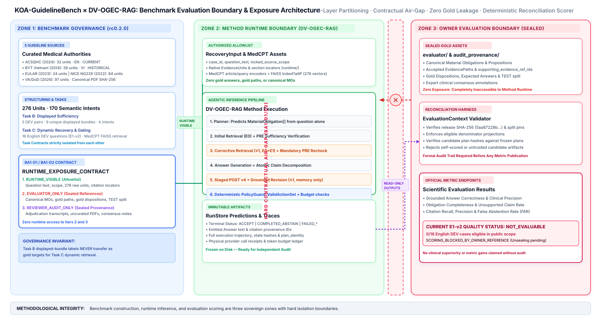

# Benchmark Specification — `KOA-GuidelineBench` (`rc0.2.0`)

This document describes the structure, provenance, task contracts, exposure governance, and evaluation boundaries of **`KOA-GuidelineBench` (`rc0.2.0`)**, as verified from the benchmark's public/runtime documentation (`REVIEW_RELEASE_MANIFEST.json`, `BENCHMARK_MANIFEST.json`, `RUNTIME_CONTRACT.md`, `RESEARCHER_ADJUDICATION.md`, and `EXPOSURE_MATRIX.md`) and the source repository data card (`docs/experiments/KOA_SYSTEM_HANDOFF.md` and `docs/experiments/KOA_FINAL_ENGINEERING_AND_RESEARCH_CLOSURE.md`).

> [!WARNING]
> **Release & Rights Status:** `KOA-GuidelineBench rc0.2.0` is an **internal successor review candidate** (`status = "REVIEW_RELEASE_CANDIDATE"`, `public_release = false`), succeeding the immutable `rc0.1.0` archive (`b44fe8b67325ea980dec0c526fb0cccfcd14d464b4e4bc88b0a74543e8358b5b`). Both `license_status` and `redistribution_status` across all five clinical guideline sources are recorded as **`UNVERIFIED`**. Consequently, this public repository publishes **only** structural descriptions, cardinalities, bibliographic citations, and cryptographic SHA-256 digests—never raw guideline full text, evidence-unit quotations, or sealed reference labels.

---

## 1. Benchmark Purpose and Release Identity

`KOA-GuidelineBench` is designed to evaluate **evidence sufficiency verification** and **iterative evidence recovery / gating** over multi-authority clinical practice guidelines for knee osteoarthritis (KOA).

In standard RAG benchmarks, models are often evaluated solely on final answer string similarity or multiple-choice accuracy, which obscures whether the system:
1. Recognized when retrieved guideline passages were insufficient to support all clinical qualifiers of a question;
2. Obeyed explicit source-authority constraints (e.g., current international guidelines vs. historical national guidelines);
3. Distinguished between fixed displayed-bundle evaluation and open-corpus retrieval recovery.

### 1.1 Pinned Cryptographic Release Identities (`rc0.2.0`)

| Benchmark Artifact / Layer | Pinned SHA-256 Digest | Role in System |
| :--- | :--- | :--- |
| `REVIEW_RELEASE_MANIFEST.json` (`release_manifest_sha256`) | `eda0e26c1832f41150b37da7780076f9ea04f55927765faaee3b4a2047e5985b` | Top-level review release manifest |
| `runtime/BENCHMARK_MANIFEST.json` (`runtime_manifest_sha256`) | `6538ef4413ebf4a3ee52cb06defd3420da7c7958cedcb017e9c8bf66505ecb47` | Inference-only runtime manifest (`inference_only = true`) |
| `runtime/RUNTIME_EXPOSURE_CONTRACT.json` | `4d9ee4cfa656b0ac5dbf13b5b22dccf37d69b6250c5b17c7e133e2237387caa4` | Field-level allowlist enforced before runtime dispatch |
| `runtime/data/knowledge/evidence_units.jsonl` | `f9cdcccd5a0e97784ee59ceeb43292a6a8419c61ed6825180e37256e66e1de52` | 276 native guideline evidence units |
| `runtime/data/knowledge/semantic_intents.jsonl` | `25f6ab07a0081d60500934c6d193d660e8af605898b14af635e2e76e188dfefc` | 170 shared semantic intent metadata records |
| `runtime/data/knowledge/sources.jsonl` | `0e1c6c319ec457af926aa0014686b7029e9d9f5be6cb0e6db8d761f78c943aec` | 5 clinical practice guideline source records |
| `runtime/data/recovery/dev_cases.jsonl` | `9aac37bd302cb10d436e2d6f497878b88d3db7be395c23ee31091417f1b3e740` | 16 Task C Recovery DEV case inputs |
| `runtime/data/sufficiency/dev_pairs.jsonl` | `8292b6143757f238ef82fba1539c1f094645be6c94c919a1c7e96e766d72a418` | 5 Task B Sufficiency DEV paired bundle inputs |
| `runtime/data/splits/dev.json` | `0e9adf3a36bd7810be6dd04b2ed82428a334742064593c54dad8e849eba904ba` | Minimal runtime DEV split assignment |
| Public Typed DEV Assignment (`dev_e1.py`) | `987f2bb21f0844ea1b9a041f686bec66296f60bc05883bd629c429ad5c1458f7` | Pinned 16-case Task C DEV assignment for E1 / E1-v2 |

---

## 2. Clinical Guideline Sources and Corpus Provenance

The shared knowledge corpus comprises **276 `EvidenceUnit` records** extracted from **five clinical practice guideline authorities**. Each `EvidenceUnit` carries a `source_id`, `evidence_type`, native quotation selectors and SHA-256 digests, PDF page start/end locators (`page_locator`), section/heading path (`section_locator`), document region, and source block locators (`context_ids`).

| Source ID | Source Family & Issuing Organization | Guideline Title & Version | Year | Language | Registry Scope | Evidence Units | Document SHA-256 |
| :--- | :--- | :--- | :---: | :---: | :---: | :---: | :--- |
| `acsqhc_koa_2024` | **ACSQHC** — Australian Commission on Safety and Quality in Health Care | *Osteoarthritis of the Knee Clinical Care Standard 2024* | 2024 | `en` | `CURRENT` | **32** | `2ef70f16dd914e22...dc33b1191` |
| `byt_cxuongkhop_2014` | **BYT** — Bộ Y tế (Ministry of Health, Vietnam) | *Hướng dẫn chẩn đoán và điều trị các bệnh cơ xương khớp* | 2014 | `vi` | `HISTORICAL` | **39** | `5847e62a90a0de95...85f162d1` |
| `eular_koa_2023` | **EULAR** — European Alliance of Associations for Rheumatology | *EULAR recommendations for the non-pharmacological core management of hip and knee osteoarthritis: 2023 update* | 2023 | `en` | `CURRENT` | **24** | `a72136e092db84b5...dda18581` |
| `nice_ng226_2022` | **NICE** — National Institute for Health and Care Excellence | *Osteoarthritis in over 16s: diagnosis and management* (`NG226`) | 2022 | `en` | `CURRENT` | **84** | `00605400b52b1d2b...2c30e31` |
| `va_dod_oa_2026` | **VA_DOD_2026** — U.S. Department of Veterans Affairs & Department of Defense | *VA/DoD Clinical Practice Guideline for the Non-Surgical Management of Hip & Knee Osteoarthritis* | 2026 | `en` | `CURRENT` | **97** | `0c0218f321eed164...3031021f` |
| **Total** | **5 Guideline Authorities** | — | — | `en` / `vi` | 4 `CURRENT`, 1 `HISTORICAL` | **276** | Verified against unit locators |

---

## 3. Dataset Cardinalities and Task Structure

A critical methodological rule of `KOA-GuidelineBench` is **accurate accounting of statistical units**. The DEV scope must never be described as "21 independent clinical questions."

| Benchmark Asset / Stratum | Verified Count | Unit Definition & Methodological Constraint |
| :--- | :---: | :--- |
| **Task C (`koa_recovery_evidence_gating`) — DEV** | **16** | Fixed English recovery/gating cases (`case_id`, `information_need_reference`, `locked_source_scope`). Primary study population for E1 and E1-v2. |
| **Task B (`koa_evidence_sufficiency`) — DEV** | **5 pairs** | Paired sufficiency contrasts over fixed displayed evidence bundles (not 5 independent open-retrieval QA items). |
| **Task B Displayed Bundle Appearances / Unique Bundles** | **10 / 9** | 5 pairs $\times$ 2 bundles = 10 appearances across **9 distinct bundles** (one bundle appears in two pairs). Each bundle includes English and Vietnamese query variants (`en`, `vi`). |
| **Task B Underlying Semantic Intents** | **4** | The 5 DEV sufficiency pairs map to **4 unique semantic intents** (`si_id`); pairs sharing an intent are statistically dependent. |
| **Shared `SemanticIntent` Registry** | **170** | Corpus-level intent registry (`si_id`, `information_need`, `source_scope`, `accepted_bilingual_questions`); **not** 170 gold-scored DEV QA items. |
| **Shared `EvidenceUnit` Corpus** | **276** | Retrievable passage units across the 5 sources; indexed in the frozen MedCPT FAISS `IndexFlatIP` index. |
| **E1-v2 Independently Evaluable Clinical-Quality Items (Public Scope)** | **0 / 16** | Independent clinical reference scoring is not available in the public/runtime delivery (`UNKNOWN_OWNER_TOTAL` in sealed owner scope). |

### 3.1 Why Task B Displayed-Bundle Labels Are Never Used as Gold for Task C (`E1-v2`)
- **Task B (`koa_evidence_sufficiency`)** presents the model with a **fixed, pre-selected displayed bundle** of evidence items (`SufficiencyInput.bundles[].model_visible_representation.evidence[]`). Sufficiency is adjudicated strictly with respect to that displayed bundle; a displayed bundle may even contain local context items absent from the general retrieval index.
- **Task C (`koa_recovery_evidence_gating`)** provides only a clinical question and `locked_source_scope`. The method (`DV-OGEC-RAG`) performs live dense retrieval ($E_0$) and conditional corrective retrieval ($E_1$) from the 276-unit corpus. Because $E_0$ and $E_0 \cup E_1$ are dynamically retrieved snapshots specific to each arm and replicate, **Task B displayed-bundle sufficiency labels cannot be transferred as ground-truth sufficiency labels for E1-v2 $E_0$ or $E_1$ states.**

---

## 4. Benchmark vs. Runtime vs. Independent Evaluation Boundary

*Figure 4: Three-zone architectural separation between `KOA-GuidelineBench` (`rc0.2.0`) construction/governance, `DV-OGEC-RAG` method runtime, and owner-side independent evaluation ([Mermaid source](../assets/diagrams/04-benchmark-evaluation-boundary.mmd)).*

### 4.1 Researcher Adjudication (`BA1-D1` and `BA1-D2`)
The transition from `rc0.1.0` to `rc0.2.0` was governed by two formal exposure adjudications (`runtime/RESEARCHER_ADJUDICATION.md` and `documentation/EXPOSURE_MATRIX.md`):

- **`BA1-D1` (Method-Neutral Obligation Derivation):** Canonical benchmark material obligation propositions (`material_obligations[].proposition`), component descriptions, dependency constraints, and `canonical_intent.material_qualifiers` are classified as **`EVALUATOR_ONLY`**. Methods must predict their own obligations from the model-visible question text:
  $$\text{Benchmark Canonical Obligation} \neq \text{Method-Predicted Obligation}$$
- **`BA1-D2` (Three-Layer Field Partitioning):** Every field in the benchmark release is explicitly classified into one of three non-overlapping layers:

| Exposure Layer | Package Directory | Representative Fields & Assets | Accessible to `DV-OGEC-RAG` Runtime? |
| :--- | :--- | :--- | :---: |
| **`RUNTIME_VISIBLE`** | `runtime/` | `Source` bibliographic & SHA-256 metadata; `SemanticIntent` question wording & `source_scope`; `EvidenceUnit` quotations & page/section locators; `RecoveryInput` (`case_id`, `information_need_reference`, `locked_source_scope`); `SufficiencyInput` displayed bundles; minimal `dev.json` split IDs. | **Yes** (via closed allowlist in `benchmarks/dev_e1.py`) |
| **`EVALUATOR_ONLY`** | `evaluator/` | `EvidencePath.*`, `material_obligation_coverage`, `GU_ids` / `AGU_ids`, `SufficiencyInput.gold_label`, `complete_bundle_id`, `missing_mo_ids`, `RecoveryInput.gold_disposition`, `relevant_evidence_ids`, `supporting_evidence_ref_ids`, `expected_answer`, canonical split definitions. | **No — Strictly Forbidden** |
| **`REVIEWER_AUDIT_ONLY`** | `audit_provenance/` | Full `canonical_intent`, `source_record`, `review_metadata`, `approval_ledger_id`, `researcher_status`, `lineage`, `shortcut_confound_annotations`, and inherited audit archive. | **No — Strictly Forbidden** |

### 4.2 Pre-Dispatch Runtime Contract Verification
Before any experiment cell is dispatched (`benchmarks/contracts.py` and `research/e1_engine.py`), `bind_bundle`:
1. Verifies the SHA-256 digests of the release manifest, runtime manifest, public typed DEV assignment, evidence corpus, and frozen MedCPT FAISS index;
2. Rejects any corpus or sample object containing unknown fields, QA answer keys, or `EVALUATOR_ONLY` attributes;
3. Writes `traces/benchmark-contract.json` inside the immutable run directory and binds the resulting `GoldFreeRuntimeInput` identity to every shared preparation and arm cell.

### 4.3 External Benchmark Adapter (`DocOA` Smoke Boundary)
In addition to `KOA-GuidelineBench rc0.2.0`, the source repository includes a read-only structural adapter (`benchmarks/docoa.py`, `benchmarks/docoa.json`) for the public Osteoarthritis Benchmark (`openmedlab/Osteoarthritis-Benchmark`, commit `ed05e1e2aa61db86db30d7eb3ff6fe32498f33f0`, Apache-2.0 repository license; `GIQA` = 337 rows, `MOQA` = 145 rows, filtered via deterministic rule `docoa.explicit-knee-target.v1`). While the structural adapter and reference isolation pass offline validation, `DocOA` lacks a matched passage retrieval corpus and qualified clinical answer scorer in this scope, and is therefore classified as **`ADAPTER_PASS / SCIENTIFIC_RAG_NOT_QUALIFIED`**.
