# Experimental Design — Protocol `E1-v2`

This document specifies the prospective experimental design registered in **`docs/experiments/E1_V2_SCIENTIFIC_PROTOCOL.md`** (protocol ID `e1-v2.refined-full-primary.v2`, experiment ID `e1_pre_v2`, protocol lock SHA-256 `98ad86c861986f3794d9b5818cafe44d396967340faf3631d6fb06d91006e5a3`, configuration SHA-256 `5ce81a22cf4cbb828f9d20a1698934fa8add4697076d13b4dfd2a989754ed5cd`).

> [!NOTE]
> **Prospective Protocol Registration vs. Empirical Claim:** Protocol `e1-v2.refined-full-primary.v2` registers a **prospective, DEV-tuned exploratory component study**. It defines experimental arms, shared state bindings, permutation schedules, and statistical estimands prior to real-provider execution. It does **not** report an empirical improvement or clinical superiority claim.

---

## 1. Study Lineage and Prospective Freeze Boundary

- **Historical Foundation (`E1` on `v3`):** Earlier exploratory runs (such as `20261018T172729644801Z-f1d774719c05423a`) used the two-arm `e1.compact-grounded-staged-post.v3` contract. Those runs remain frozen historical artifacts; their two-arm protocol and historical eight-case `EVIDENCE_FOUND` strata are not transferred to `E1-v2`.
- **Predecessor `E1-v2` v1 (`e1-v2.question-visibility.v1`):** Preserved byte-for-byte under `experiments/e1_pre_v2/protocols/e1-v2.question-visibility.v1/` (lock SHA-256 `85310854aaea4a1d2ca57095e5c63416b3da9813836ebddcf772e6544668575a`), where `A1` vs. `A0` was originally designated primary.
- **Active Successor `E1-v2` v2 (`e1-v2.refined-full-primary.v2`):** Authorized prospectively before any real-provider `E1-v2` execution on the `e1.member-bound-staged-post.v4` runtime foundation. It designates **`A1` vs. `G`** as the primary policy comparison, **`A1` vs. `A0`** as the mechanistic question-visibility ablation, and **`A0` vs. `G`** as the supporting legacy contrast.

---

## 2. Three-Arm Experimental Architecture (`A0`, `A1`, `G`)

*Figure 5: Three-arm experimental design (`A0`, `A1`, `G`) under protocol `e1-v2.refined-full-primary.v2`, showing shared `(question_id, replicate)` preparation, arm-specific PRE contracts and corrective query builders, matched downstream `v4` execution, and the three registered comparisons ([Mermaid source](../assets/diagrams/05-experimental-arms.mmd)).*

### 2.1 Arm Definitions and Intervention Boundaries

| Namespace & Arm ID | Native Variant ID | PRE Input Contract | PRE Prompt & Schema | Readiness & Gating Rule | Corrective Query Formulation ($\le 1$) | Downstream Pipeline (`GENERATE` $\rightarrow$ `POST` $\rightarrow$ `PolicyGuard`) | Scientific Role |
| :--- | :--- | :--- | :--- | :--- | :--- | :--- | :--- |
| **`E1V2:A0`** (`A0`) | `METHOD_FULL_DVOGEC` | `original`: Shared `Plan` + eligible $E_0$ (**Question text hidden at PRE**) | Obligation-guided FULL instruction & closed per-obligation schema (`PRE_WIRE`) | Deterministic all-obligation readiness (every planned obligation `READY`, zero unresolved discrepancies) | `CorrectionPlanner` + `CorrectiveQueryBuilder` (`OBLIGATION_TARGETED_CORRECTION`) | Shared `Plan`, `Generator`, `Decomposer`, `Staged POST v4`, `Revision <= 1`, `PolicyGuard` | **Original FULL PRE** (ablation reference & supporting comparator) |
| **`E1V2:A1`** (`A1`) | `METHOD_FULL_DVOGEC` | `e1-v2.pre.question-plan-evidence.v1`: **Original `RuntimeQuestion`** + same `Plan` + same eligible $E_0$ | Identical instruction and output schema as `A0` (`PRE_WIRE`) | Identical deterministic all-obligation readiness (Question contextualizes obligations but cannot drop/alter obligations or thresholds) | `CorrectionPlanner` + `CorrectiveQueryBuilder` (`OBLIGATION_TARGETED_CORRECTION`) | Identical to `A0` (`phase4.common-minimal-ready.v1` + `v4`) | **Revised FULL PRE** (primary intervention arm) |
| **`E1V2:G`** (`G`) | `MATCHED_GENERIC_PRESTATE` | `Original RuntimeQuestion` + eligible $E_0$ + public `SourcePolicy` + previous generic gaps (**No `Plan` in PRE**) | Generic sufficiency instruction & `GenericPreState` schema (`sufficient`, free-text `missing_information`) | Boolean `generic.sufficient` check | `MatchedGenericQueryBuilder` from `generic.missing_information` (`GENERIC_GAP`) | Receives the **same shared `Plan`** downstream for generation, decomposition, `Staged POST v4`, `Revision <= 1`, and `PolicyGuard` | **Matched Generic Baseline** (primary baseline comparator) |

### 2.2 Causal Interpretation Caveat for `A1` vs. `G`
While `A1` and `G` share the exact same `(question_id, replicate)` preparation (`RuntimeQuestion`, `Plan`, $E_0$, locked `SourcePolicy`) and identical downstream generation/POST/guard components, their PRE stages differ across multiple bundled dimensions:
1. Presence vs. absence of `Plan.obligations` in PRE;
2. Structured per-obligation readiness reduction vs. holistic boolean sufficiency;
3. Obligation-targeted corrective query construction vs. free-text gap query construction;
4. Prompt length, source-policy representation, and previous-gap state formatting.

Therefore, **`A1` vs. `G` evaluates the comparative effectiveness of two complete, implemented PRE policy bundles**; it does not isolate a single atomic causal variable. Conversely, **`A1` vs. `A0` is a clean mechanistic ablation** that isolates the effect of providing the original `RuntimeQuestion` in PRE while holding the obligation policy, prompt instructions, and output schema strictly constant.

---

## 3. Shared Block Preparation, Replication, and Counterbalancing

To eliminate upstream variance between arms within a replicate, `E1-v2` enforces a **blocked, shared-preparation design**:

1. **Population:** All **16 English Task C Recovery DEV questions** from `KOA-GuidelineBench rc0.2.0` (pinned assignment SHA-256 `987f2bb21f0844ea1b9a041f686bec66296f60bc05883bd629c429ad5c1458f7`).
2. **Replication:** **3 independent preparations (replicates $r \in \{1, 2, 3\}$)** per question, yielding $16 \times 3 = \mathbf{48\text{ shared preparations}}$ and $48 \times 3 = \mathbf{144\text{ planned arm cells}}$.
   - *Statistical Unit Invariant:* The **clinical question ($N = 16$)** remains the independent statistical unit; replicates are nested within questions ($48$ preparations are never treated as $48$ independent questions).
3. **Shared Preparation Execution (`prepare_shared_block`):**
   - For each `(question_id, replicate)` block, the engine executes `PLAN_QUESTION_ONLY` **once** and `INITIAL_RETRIEVAL` **once**.
   - Before any arm cell (`A0`, `A1`, `G`) in that block is dispatched, the engine cryptographically binds: `question_id`, `question_text` SHA-256, `plan_identity` hash, $E_0$ bundle hash, `substrate_hash`, and `locked_source_scope`.
   - The eligible evidence payload delivered to `A0` and `A1` at initial PRE is byte-identical.
4. **Counterbalanced Arm Dispatch Order:**
   - Across the 48 sorted `(question_id, replicate)` blocks, the three arms are dispatched in **six rotating permutations** of `(A0, A1, G)`:
     $$\{(A_0, A_1, G),\ (A_0, G, A_1),\ (A_1, A_0, G),\ (A_1, G, A_0),\ (G, A_0, A_1),\ (G, A_1, A_0)\}$$
   - Across 48 blocks, each of the 6 permutations appears exactly **8 times**, and each arm appears in dispatch position 1, 2, and 3 exactly **16 times**. Both planned and actual dispatch orders are persisted in `RunStore`.

### 3.1 Campaign Profiles and Physical Request Ceilings

| Campaign Plan Profile | Distinct DEV Questions | Replicates per Question | Arms | Shared Preparations | Total Arm Cells | Physical Pipeline Request Ceiling | Plan Hash (SHA-256) |
| :--- | :---: | :---: | :---: | :---: | :---: | :---: | :--- |
| **Legacy `E1` (Historical Reference)** | 16 | 3 | 2 (`FULL`, `GENERIC`) | 48 | 96 | $96 \times 34 + 48 = \mathbf{3,312}$ | — |
| **`E1-v2` Full Parent Plan (`full`)** | 16 | 3 | 3 (`A0`, `A1`, `G`) | 48 | **144** | $144 \times 34 + 48 = \mathbf{4,944}$ | `f11bd863d697dce5...e921c9b751a1c3b4cca1` |
| **`E1-v2` Engineering Child Plan (`pilot3`)** | 3 (first 3 sorted IDs) | 1 | 3 (`A0`, `A1`, `G`) | 3 | **9** | $9 \times 34 + 3 = \mathbf{309}$ (+14 extended qualification = **323**) | `8a0c52f6e7c5bd6c...949d120e0f2810caa43ba364` |

> *Note:* The physical ceiling of **34 requests per arm cell** accounts for worst-case batched member-bound POST (`pair`, `diagnosis`, `remedies`) across initial generation and one revision cycle. It is an accounting upper bound for budget reservation, not typical per-cell request usage. The 3-question `pilot3` plan is strictly tagged **`DEV_ENGINEERING_PILOT_NOT_CONFIRMATORY`**.

---

## 4. Metric Hierarchy, Estimands, and Statistical Inference Rules

The evaluation subsystem (`research/evaluation.py` and `research/e1_v2.py`) enforces a strict four-tier separation of metrics:

### Tier 1 — Official Reference-Scored Scientific Endpoints (`reference_scored`)
- **Endpoints:** False Abstention Rate (FAR), verified clinical answer correctness, grounded claim support, and obligation completeness.
- **Requirement:** Independently reconciled owner reference context (`EvaluationContext`) and a qualified three-arm E1-v2 scoring contract.
- **Current Status:** **`NOT_EVALUABLE_WITHOUT_REFERENCE_SCORING`** (`0/16` eligible items in the authorized scope; `SCORING_BLOCKED_BY_OWNER_REFERENCE`). All scalar quality point estimates and quality confidence intervals are explicitly `null`.

### Tier 2 — Controller-Observed Behavioral Outcomes (`controller_observed`)
- **Endpoints:** Initial PRE readiness (`initial_PRE_ready` on shared $E_0$), final PRE readiness (after conditional correction on $E_0 \cup E_1$), corrective retrieval rate, valid terminal abstention count (`COMPLETED_ABSTAIN`), candidate generation count, grounded revision count, and controller acceptance count (`COMPLETED_ANSWER`).
- **Registered Behavioral Estimand ($\Delta_{\text{ready}}$):** For each pairwise contrast $(X, Y) \in \{(A_1, G),\ (A_1, A_0),\ (A_0, G)\}$, the descriptive initial-readiness contrast is the mean across $Q = 16$ questions of the within-question mean across $R = 3$ matched replicates:
  $$\hat{\Delta}_{\text{ready}}(X, Y) = \frac{1}{16} \sum_{q=1}^{16} \left( \frac{1}{3} \sum_{r=1}^{3} \Big[ \mathbb{I}(\text{initial\_PRE\_ready}_{q,r,X}) - \mathbb{I}(\text{initial\_PRE\_ready}_{q,r,Y}) \Big] \right)$$
- **Cluster Bootstrap Rule:** An exploratory 95% percentile paired question-cluster bootstrap interval (resampling the 16 question-level differences with replacement $20,000$ times, fixed seed `401`, linear interpolated 2.5th/97.5th percentiles) is computed **only when**:
  1. Execution mode is `LIVE` (never computed on `MOCK` runs); and
  2. All 16 questions have all 3 observed binary initial-PRE gates for both compared arms (zero missingness).
- **Strict Interpretation Rule:** Controller acceptance (`ACCEPT`) and initial PRE readiness are **policy behavior observations**, never substitutes for clinical accuracy or FAR denominators.

### Tier 3 — Diagnostic Proxies (`diagnostic`)
- Readiness transition matrices (`INSUFFICIENT` $\rightarrow$ `READY` after correction) and stage-specific contract/output failure counts (`failure_taxonomy.py`).

### Tier 4 — Technical & Accounting Telemetry (`technical`)
- Attempted, persisted, valid, failed, and unattempted cell counts (out of 144); physical request counts; settled conservative USD cost; pending reservations/liabilities; input/output/reasoning token counts; and wall-clock elapsed time.

---

## 5. Missingness, Failure Handling, and Threats to Validity

- **Complete 144-Cell Inventory:** Unattempted cells remain explicitly marked `UNATTEMPTED` / missing and are never imputed as `ABSTAIN`. If any planned gate in a contrast is missing, aggregate point estimates and bootstrap CIs are suppressed in favor of raw observed counts and missing IDs.
- **No Silent Retries:** Provider transport runs with `concurrency = 1` and `zero automatic retries`. An interrupted request with unknown billing retains its budget reservation and halts dispatch fail-closed.
- **Documented Threats to Validity:** Small DEV sample size ($16$ questions across $4$ underlying semantic intents in Task B), iterative DEV tuning across historical milestones (`M4`–`M6`), unresolved provider model alias (`gpt-5.6-luna`), all-obligation gating sensitivity to planner wording, and differences in prompt length/history between `FULL` and `GENERIC` arms restrict external generalization until an independent held-out evaluation is authorized.
