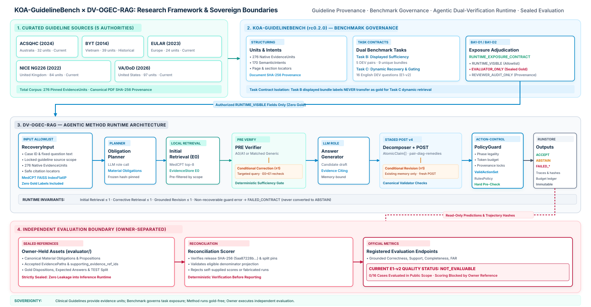

# Research Overview

**System:** KOA Agentic-RAG System  
**Scientific Subtitle:** Evidence-Grounded Agentic Retrieval-Augmented Generation for Knee Osteoarthritis Clinical Guidelines  
**Connected Contributions:** `KOA-GuidelineBench` (`rc0.2.0`) × `DV-OGEC-RAG`

---

## 1. Problem Statement

Clinical question answering over clinical practice guidelines (CPGs) requires more than top-$k$ passage retrieval followed by unconstrained free-text synthesis. Guideline recommendations are typically conditional on patient population, disease severity, comorbidities, modality constraints, and issuing clinical authority. When a retrieval-augmented generation (RAG) pipeline answers a multi-faceted clinical question, three failure modes frequently arise:

1. **Pre-generation evidence insufficiency:** Initial retrieval ($E_0$) may cover only a subset of the clinical obligations implied by the question, omit mandatory population qualifiers, or draw from out-of-scope guideline sources. Generating an answer from incomplete evidence risks plausible-sounding omissions or unsupported extrapolation.
2. **Unbounded or ungrounded post-generation claims:** Even when retrieved passages are relevant, a language model may synthesize composite claims that exceed the scope of cited evidence units, conflate distinct guideline authorities, or leave material sub-questions unaddressed.
3. **Absence of deterministic answer control:** Relying solely on model self-confidence or unstructured reflection tokens to decide whether to retrieve again, revise, accept, or abstain makes it difficult to enforce hard invariants on provenance, source eligibility, call budgets, and claim-level support.

---

## 2. Research Gap

Existing biomedical RAG benchmarks and reflective RAG architectures address important subsets of this problem, yet leave a structural gap when applied to clinical practice guidelines:

- **Multiple-choice medical QA vs. obligation-structured guideline synthesis:** Standard medical QA benchmarks (such as PubMedQA, MedMCQA, USMLE-style datasets, and their aggregation in MIRAGE) primarily evaluate closed-form option selection rather than multi-obligation clinical guideline adherence, source-scoped evidence gating, and selective abstention under incomplete retrieval.
- **Unstructured self-reflection vs. typed dual verification:** Reflective RAG frameworks (e.g., Self-RAG, Corrective RAG) introduce retrieval grading and post-hoc critique, but typically formulate sufficiency around generic relevance rather than explicit question-derived material obligations, and rarely separate model-generated assessments from a deterministic, non-LLM policy guard.
- **Evaluation leakage and task conflation:** In clinical RAG evaluation, benchmark reference decompositions, accepted evidence paths, and bundle-level sufficiency annotations must be strictly isolated from method runtime so that a system predicts its own obligations and executes genuine corpus retrieval rather than conditioning on benchmark-internal gold structures.

---

## 3. Research Objectives

The KOA Agentic-RAG System investigates how an **independently governed clinical guideline benchmark (`KOA-GuidelineBench`)** and an **obligation-guided, dual-verification agentic RAG architecture (`DV-OGEC-RAG`)** can be designed and experimentally evaluated under strict provenance, budget, and evaluation boundaries:

1. **Formulate an explicit benchmark–method separation (`KOA-GuidelineBench rc0.2.0`):** Structure multi-source knee osteoarthritis (KOA) guideline evidence into verifiable units with cryptographic provenance, define displayed-bundle sufficiency (Task B) and corpus recovery/evidence-gating (Task C) contracts, and enforce a three-layer exposure matrix (`RUNTIME_VISIBLE`, `EVALUATOR_ONLY`, `REVIEWER_AUDIT_ONLY`).
2. **Design an obligation-guided dual-verification workflow (`DV-OGEC-RAG`):** Decompose a clinical question into predicted material obligations prior to retrieval verification; gate generation on deterministic all-obligation readiness with at most one bounded corrective retrieval; and gate final emission on atomic claim decomposition, member-bound staged post-generation verification, and at most one grounded revision.
3. **Enforce deterministic controller governance:** Separate probabilistic LLM role observations from deterministic action authorization (`ValidActionSet` $\rightarrow$ `DeterministicRulesPolicy` $\rightarrow$ `PolicyGuard` $\rightarrow$ `WorkflowActionExecutor`), ensuring that model confidence never overrides provenance, source-scope, or support checks.
4. **Register a prospective, controlled experimental protocol (`E1-v2`):** Compare refined obligation-guided PRE with original-question visibility (`A1`), original plan-only FULL PRE (`A0`), and a matched generic pre-state baseline (`G`) on a shared preparation substrate (`48` question-replicate preparations, `144` planned arm cells).

---

## 4. Research Questions and Registered Hypotheses

Under the active prospective protocol (`e1-v2.refined-full-primary.v2`, lock SHA-256 `98ad86c861986f3794d9b5818cafe44d396967340faf3631d6fb06d91006e5a3`), the study addresses three structured comparisons on the 16-case Task C Recovery DEV population:

| Comparison | Arms Compared | Scientific Role | Registered Hypothesis & Interpretive Scope |
| :--- | :--- | :--- | :--- |
| **RQ1 — Primary Policy Comparison** | `A1` vs. `G` | Primary comparison | Tests whether refined obligation-guided PRE (`A1`) yields better evidence-grounded decision quality than matched generic PRE (`G`). **Interpretive boundary:** Compares two implemented policy bundles that differ in prompt structure, gap representation, history, and obligation gating; it does *not* isolate a single causal variable. |
| **RQ2 — Mechanistic Ablation** | `A1` vs. `A0` | Question-visibility ablation | Tests whether providing the original clinical question alongside the predicted plan and eligible evidence in PRE (`A1`) changes initial PRE readiness relative to plan-plus-evidence alone (`A0`) under identical instructions, output schema, and all-obligation gating. Increased controller readiness alone is not a proof of clinical quality improvement. |
| **RQ3 — Supporting Baseline Contrast** | `A0` vs. `G` | Supporting comparison | Characterizes the original plan-only FULL PRE policy (`A0`) against the matched generic policy (`G`) on the common prospective `e1.member-bound-staged-post.v4` runtime. |

> [!IMPORTANT]
> **Evaluation Status Qualification:** Official scientific quality endpoints (verified answer correctness, grounded support, completeness, and false abstention rate) require independently reconciled owner/reference scoring and are currently registered as **`NOT_EVALUABLE_WITHOUT_REFERENCE_SCORING`** (`0/16` eligible items in the public scope). Controller-observed readiness and acceptance rates are descriptive behavioral observations, never proxies for clinical truth.

---

## 5. System Scope and Two Connected Contributions

*Figure 1: Overall research framework connecting clinical guideline sources, `KOA-GuidelineBench` (`rc0.2.0`), gold-free DEV runtime inputs, the `DV-OGEC-RAG` agentic runtime, and the owner-separated evaluation boundary ([Mermaid source](../assets/diagrams/01-research-framework.mmd)).*

### 5.1 Contribution 1 — `KOA-GuidelineBench` (`rc0.2.0`)
An internal review-candidate benchmark built from **five clinical practice guideline sources** covering knee osteoarthritis management (**276 native evidence units** and **170 semantic intents** across English and Vietnamese sources). Its primary methodological contribution is **governance and exposure hygiene**:
- **Researcher Adjudication (`BA1-D1` / `BA1-D2`):** Canonical material obligations, accepted evidence paths, and gold outcomes are strictly withheld from runtime (`benchmark canonical obligation != method-predicted obligation`).
- **Task Contracts:** Separates **Task B** (`koa_evidence_sufficiency` over fixed displayed bundles: 5 DEV pairs, 9 unique bundles, 4 semantic intents) from **Task C** (`koa_recovery_evidence_gating` over corpus retrieval: 16 English DEV cases).

### 5.2 Contribution 2 — `DV-OGEC-RAG` Method and Research Engine
A modular, typed agentic RAG framework implementing:
- **Question-Only Obligation Planning:** Predicts `MaterialObligation` items and optional source constraints without access to benchmark gold.
- **Dual Verification (`PRE` and `POST`):** Combines pre-generation obligation readiness checks (with at most one targeted corrective retrieval round) and post-generation atomic claim verification (`e1.member-bound-staged-post.v4`, with at most one grounded revision round).
- **Deterministic Action Control:** Every effectful step (`RETRIEVE`, `GENERATE`, `REVISE`, `ACCEPT`, `ABSTAIN`) is gated by `ValidActionSet`, `DeterministicRulesPolicy`, and `PolicyGuard`.
- **Audit-Grade Experiment Infrastructure:** Shared block preparation, six rotating arm-order permutations, append-only `RunStore` receipts, conservative pre-dispatch budget reservation, and read-only evaluation reconciliation.

---

## 6. Attribution and Boundaries

- **Authorship & Attribution:** This research system documentation and the `DV-OGEC-RAG` experimental integration are authored by **Phạm Hồng Đăng Khoa** (`KwanFam26022005`) and **Nguyễn Hoàng Khang**. `KOA-GuidelineBench` (`rc0.2.0`) is maintained under separate benchmark-owner governance (`public_release = false`), and its owner-held evaluator capsule and gold references remain external to the method runtime.
- **Non-Clinical Research Status:** This repository documents a software and methodological research system. It is **not** a clinical decision support tool, has **not** undergone real-provider comparative execution (`REAL_PROVIDER: NOT_EXECUTED`), and makes **no** claims of clinical efficacy, medical safety, or superiority over baseline RAG methods.
