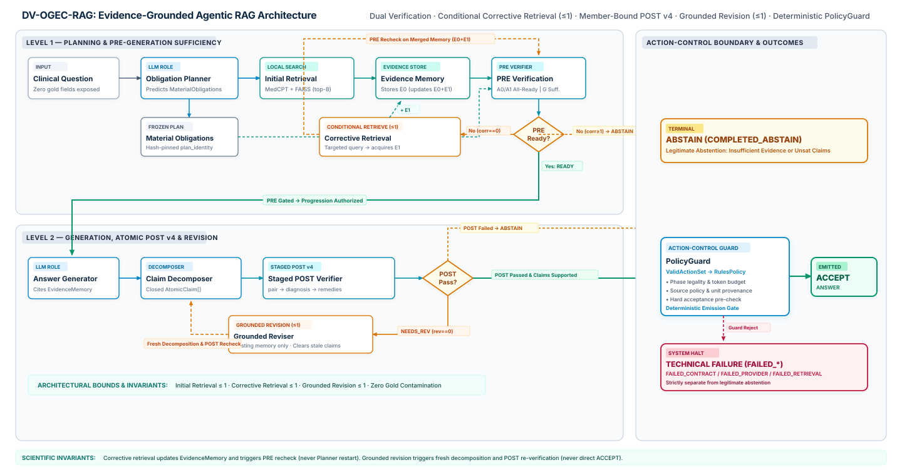

# System Architecture

This document specifies the source-aligned architecture of the **KOA Agentic-RAG System**, detailing the separation between `KOA-GuidelineBench` (`rc0.2.0`), the `DV-OGEC-RAG` agentic runtime, the deterministic control plane, and the external evaluation boundary.

---

## 1. Architectural Principles and Invariants

The system architecture enforces four non-negotiable engineering and scientific invariants verified in the qualified baseline (`ac4ade796e56377882b8069d0fb7a14809e8180b`, scientific source hash `5aa87228b07ead1c4ecde48e7330e62771a86dbed7ac0fc4097f50152d306f5b`):

1. **Strict Role Isolation via Closed Typed Contracts:** Every pipeline stage (`Planner`, `Retriever / EvidenceMemory`, `PRE Verifier`, `Generator`, `Claim Decomposer`, `POST Verifier`, `Reviser`, and `Controller`) communicates exclusively through immutable dataclasses with closed field validation. Arbitrary untyped metadata dictionaries and gold-bearing fields are rejected at construction time.
2. **Separation of Probabilistic Observation and Deterministic Control:** LLM roles produce structured *observations* (`Plan`, `PreVerificationObservation`, `GenericPreState`, `AnswerObservation`, `AtomicClaim[]`, `StagedPostObservation`). They never directly trigger retrieval, emit a final answer, or override state transitions. All state transitions and terminal decisions are governed deterministically by `ValidActionSet`, `DeterministicRulesPolicy`, `PolicyGuard`, and `WorkflowActionExecutor`.
3. **Bounded Agentic Execution:** Iterative retrieval and revision are strictly bounded per arm execution cell:
   - Initial retrieval: $\le 1$
   - Corrective retrieval: $\le 1$ (total retrieval rounds $\le 2$)
   - Grounded answer revision: $\le 1$
   - Physical LLM requests per arm cell: $\le 34$ (plus $1$ shared Planner request per question-replicate block)
4. **Zero Evaluation Leakage:** Inference binds only the `runtime/` layer of `KOA-GuidelineBench rc0.2.0` (`GoldFreeRuntimeInput` / `DevSample`). Canonical benchmark obligations, accepted evidence paths, and gold dispositions reside exclusively in the owner-separated `evaluator/` and `audit_provenance/` layers.

---

## 2. Principal Agentic Architecture Diagram

*Figure 2: Full execution architecture of `DV-OGEC-RAG`, illustrating shared question-replicate preparation, local MedCPT dense retrieval, PRE sufficiency verification, conditional corrective retrieval ($\le 1$), candidate generation, atomic claim decomposition, member-bound staged POST verification (`v4`), conditional grounded revision ($\le 1$), and the deterministic `PolicyGuard` control plane ([Mermaid source](../assets/diagrams/02-agentic-rag-architecture.mmd)).*

---

## 3. Component Classification: LLM vs. Retrieval vs. Deterministic Control

A core design requirement for auditable clinical RAG is making explicit which components invoke a language model, which execute deterministic local retrieval, and which enforce deterministic runtime verification and action guards.

| Component / Stage | Execution Type | Runtime Role / Module | Primary Input | Primary Output | Can Terminate Run? |
| :--- | :--- | :--- | :--- | :--- | :--- |
| **1. Obligation Planner** | **LLM Role** (`planner`) | `PLAN_QUESTION_ONLY` | `RuntimeQuestion` (`sample_id`, `question_text`) | Frozen `Plan` (`MaterialObligation[]`, optional `source_constraint`) | Technical failure (`FAILED_CONTRACT` / `FAILED_PROVIDER`) if empty or malformed |
| **2. Authority Binding** | **Deterministic** | `bind_plan_authorities` | `Plan` + index `Source` registry | Immutable `AuthorityBinding` map + `SourcePolicy` | Technical failure if invalid constraint |
| **3. Initial Retrieval ($E_0$)** | **Local Dense Retrieval** (No LLM) | `INITIAL_RETRIEVAL` (`KOAMedCPT` + FAISS) | `question_text`, `SourcePolicy` allowlist, `top_k = 8` | `EvidenceItem[]` ($E_0$) committed to `EvidenceMemory` | Technical failure (`FAILED_RETRIEVAL` / `FAILED_QUERY_*`) |
| **4. PRE Verifier (Arms A0/A1)** | **LLM Role** (`pre_verifier`) | `OBLIGATION_VERIFICATION` | `Plan` + `EvidenceMemory` (+ `RuntimeQuestion` in `A1`) | `PreVerificationObservation` (per-obligation coverage, source validity, discrepancies) | Technical failure if obligation IDs mismatch or citations do not resolve |
| **4b. Generic Judge (Arm G)** | **LLM Role** (`generic_judge`) | `GENERIC_SUFFICIENCY` | `RuntimeQuestion` + `EvidenceMemory` + `SourcePolicy` + prior gaps | `GenericPreState` (`sufficient`, `missing_information`) | Technical failure if schema/reference check fails |
| **5. PRE Readiness Reducer** | **Deterministic** | `PreVerificationObservation.is_ready` | Per-obligation observations | Normalized `VerificationStatus` (`READY` vs. `INSUFFICIENT`) | No (feeds gate / correction condition) |
| **6. Corrective Query Builder** | **Deterministic** | `CorrectionPlanner` + `CorrectiveQueryBuilder` / `MatchedGenericQueryBuilder` | `RuntimeQuestion`, uncovered obligations or generic gap, `AuthorityBinding` | Versioned corrective query string + source constraints | Technical failure (`FAILED_QUERY_CONSTRUCTION` / `FAILED_QUERY_LENGTH`) |
| **7. Corrective Retrieval ($E_1$)** | **Local Dense Retrieval** (No LLM) | `CORRECTIVE_RETRIEVAL` (`corrective <= 1`) | Corrective query, source constraints, `top_k = 8` | Merged `EvidenceMemory` ($E_0 \cup E_1$) | Technical failure (`FAILED_RETRIEVAL`) |
| **8. PRE Evidence Gate** | **Deterministic Gate** | `PRE_EVIDENCE_GATE` | Current `sufficient()` boolean | Authorizes progression to `GENERATE` or triggers `authorize(ABSTAIN)` | **Yes:** Legitimate `COMPLETED_ABSTAIN` if `sufficient() == false` |
| **9. Answer Generator** | **LLM Role** (`generator`) | `GENERATE` | `RuntimeQuestion`, `Plan`, `EvidenceMemory`, `PreVerification` | `AnswerObservation` (`answer_id`, `text`, `citation_evidence_ids`) | Technical failure if empty text or unresolvable citation IDs |
| **10. Claim Decomposer** | **LLM Role** (`decomposer`) | `DECOMPOSE` | `Plan`, `AnswerObservation` | Closed tuple of `AtomicClaim` items (`claim_id`, `text`, `obligation_ids`, `citation_evidence_ids`) | Technical failure if empty or duplicate claim IDs |
| **11. Atomic POST Verifier** | **LLM Role** (`post_verifier`, Staged POST v4) | `ATOMIC_VERIFICATION` | `RuntimeQuestion`, `Plan`, `EvidenceMemory`, `AnswerObservation`, `AtomicClaim[]` | `StagedPostObservation` (`pair` $\rightarrow$ `diagnosis` $\rightarrow$ `remedies` passes) | Technical failure on unresolved pair/alias/span binding |
| **12. Canonical POST Validator** | **Deterministic** | `validate_canonical_post` | `StagedPostObservation`, `Plan`, `AtomicClaim[]`, `EvidenceMemory` | Verified `PostVerificationStatus` (`PASS`, `NEEDS_REVISION`, `FAIL`) & `revision_possible` | Technical failure (`FAILED_CONTRACT`) if wire/binding invariant broken |
| **13. Grounded Reviser** | **LLM Role** (`reviser`, `revision <= 1`) | `REVISE` inside `REVISION_CYCLE` | `RuntimeQuestion`, `Plan`, `EvidenceMemory`, prior `AnswerObservation`, `StagedPostObservation` | New `AnswerObservation` (`revision_of = previous.answer_id`); clears old claims & POST | Technical failure if identity/reference rules violated |
| **14. POST Evidence Gate** | **Deterministic Gate** | `POST_EVIDENCE_GATE` | Post-revision `sufficient()` boolean | Proceeds to `EMIT_ANSWER` or triggers `authorize(ABSTAIN)` | **Yes:** Legitimate `COMPLETED_ABSTAIN` if `sufficient() == false` |
| **15. DecisionPolicy & PolicyGuard** | **Deterministic Control Plane** (No LLM) | `ValidActionSet` $\rightarrow$ `DeterministicRulesPolicy` $\rightarrow$ `PolicyGuard` | `DecisionView` + projected `ControllerState` / `ProfileAuthorizationState` | `GuardResult(allowed, reason_code)` authorizing `WorkflowActionExecutor` | **Yes:** `COMPLETED_ANSWER` on `ACCEPT`, `COMPLETED_ABSTAIN` on `ABSTAIN`, or `FAILED_CONTRACT` on guard rejection |

> [!NOTE]
> **Optional Selective Decision Routing (`Jev`):** The architecture defines a provider-agnostic `DecisionPolicy` interface so that an external selective router (`Jev`) can optionally propose actions from a gold-free `DecisionView` while remaining subordinate to `PolicyGuard`. Because `Jev` access is currently waitlisted, all qualified runs use the deterministic `DeterministicRulesPolicy` (`revision: canonical-rules-v1`).

---

## 4. Typed Runtime Data Contracts

The runtime state is constructed from immutable Python dataclasses defined across `dv_ogec_rag/contracts.py`, `dv_ogec_rag/runner.py`, and `dv_ogec_rag/staged_post.py`:

### 4.1 Question and Obligation Planning Contracts
- **`RuntimeQuestion`**: `(question_id: str, text: str)`. Stripped of all benchmark split metadata, task dispositions, and reference labels before reaching the `Planner`.
- **`MaterialObligation`**: `(obligation_id: str, requirement: str, kind: ObligationKind, required_for_completion: bool, source_constraint: Optional[str], population_constraint: Optional[str], qualifier: Optional[str], temporal_constraint: Optional[str], planner_confidence: Optional[float])`.
  - *Invariant:* `planner_confidence` is recorded as telemetry only and never authorizes a state transition.
  - *All-Obligation Gating Invariant:* All planned obligations in `Plan.obligations` gate FULL readiness and final answer completeness, even if the planner sets `required_for_completion = False`.
- **`Plan`**: `(plan_id: str, run_id: str, status: PlanStatus, obligations: Tuple[MaterialObligation, ...])`. Once emitted in `PLAN_QUESTION_ONLY`, its canonical SHA-256 digest (`plan_identity`) is frozen for the remainder of the cell execution; any subsequent mutation raises `RuntimeContractError("frozen plan identity changed")`.

### 4.2 Retrieval and Evidence Memory Contracts
- **Retrieval Substrate (`koa-frozen-medcpt-v1`)**:
  - **Encoders:** Dual-encoder architecture using `ncbi/MedCPT-Query-Encoder` (pinned revision `d83a36cc6b8e3a5c5e9d9d6ba156808c1643dcbc`) and `ncbi/MedCPT-Article-Encoder` (pinned revision `d05a736da4bb84ee4057b7f7999485be6ed85465`), executed offline on CPU (`float32`, eager attention, single-threaded native math libraries).
  - **Vector Index:** Exact inner-product search via `faiss.IndexFlatIP` (`dimension = 768`, `ntotal = 276` evidence units, `top_k = 8`, `reranker = NONE`, index manifest SHA-256 `902dcb37c7d038dc556c1854428dd9033d31c6f3cdee1510b2971fa70edc0acb`).
  - **Pre-Scoring Source Filtering:** When `locked_source_scope` or obligation `AuthorityBinding` restricts eligible guideline sources, candidate vectors are filtered *before* inner-product scoring rather than via post-filtering of a global top-$k$.
- **`EvidenceMemory`**: Maintains deduplicated `EvidenceItem` records across initial retrieval ($E_0$) and conditional corrective retrieval ($E_1$), preserving `evidence_id`, `source_ref`, page/section locators, document SHA-256, and retrieval round provenance.

### 4.3 PRE and POST Verification Contracts
- **`PreVerificationObservation` (FULL Arms `A0` and `A1`)**: Requires an exact 1-to-1 match between observed `obligation_id` entries and `Plan.obligations`, with all referenced `evidence_ids` resolving in `EvidenceMemory`. Readiness is derived deterministically: `status == VerificationStatus.READY` holds if and only if every planned obligation has `coverage == COVERED`, valid source alignment, and zero unresolved discrepancies.
- **`GenericPreState` (Generic Arm `G`)**: Records boolean `sufficient` and structured `missing_information` gaps under the public source policy, without exposing `Plan.obligations` during PRE.
- **`StagedPostObservation` (`e1.member-bound-staged-post.v4`)**: Decomposes post-generation verification into three auditable stages over `AtomicClaim` items and `EvidenceMemory`:
  1. **Member-Bound Pair Verification (`post_verifier_pairs`):** Evaluates claim–evidence pairs using code-owned member-pair wire bindings (`e1.member-pair-wire.per-member.v1` / `joint-bound.v2`).
  2. **Semantic Diagnosis (`post_verifier_diagnosis`):** Identifies blocking issues, hard constraint violations, and non-blocking findings using code-owned `diagnosis_identity_aliases` (`e1.diagnosis-id-aliases.v1`).
  3. **Grounded Remedies & Coverage Assessment (`post_verifier_remedies`):** Produces per-claim `ClaimSupport` (`SUPPORTED`, `UNSUPPORTED`, `CONTRADICTED`, `UNCERTAIN`), overall `AnswerCoverage` (`ADDRESSED`, `PARTIALLY_ADDRESSED`, `UNADDRESSED`), `unaddressed_obligation_ids`, and `revision_possible`.

---

## 5. Persistence, Accounting, and Evaluation Architecture

- **Append-Only `RunStore`:** Every campaign run writes to an isolated directory (`experiments/<family>/runs/<run-id>/`) containing an immutable `manifest.json` (pinning Git HEAD, scientific source hash, integration hash, protocol lock hash, config hash, and model/index identities), append-only cell observations, `traces/progress.jsonl`, and atomic `summary.json`.
- **Pre-Dispatch Financial Accounting (`RunBudget`):** Every LLM stage reserves its conservative worst-case token cost in an append-only ledger (`INTENT` before request dispatch, `USAGE` upon receipt) enforcing both the per-run `--max-cost-usd` cap and the shared historical ledger ceiling. Interrupted requests with unknown billing retain their reservation and halt the writer fail-closed.
- **Read-Only Evaluation Boundary (`research/evaluation.py` & `research/owner_scoring.py`):** Candidate predictions are exported without mutating historical run directories. Independent scoring requires a trusted `EvaluationContext` pinning release, split, plan, and owner projection hashes.
